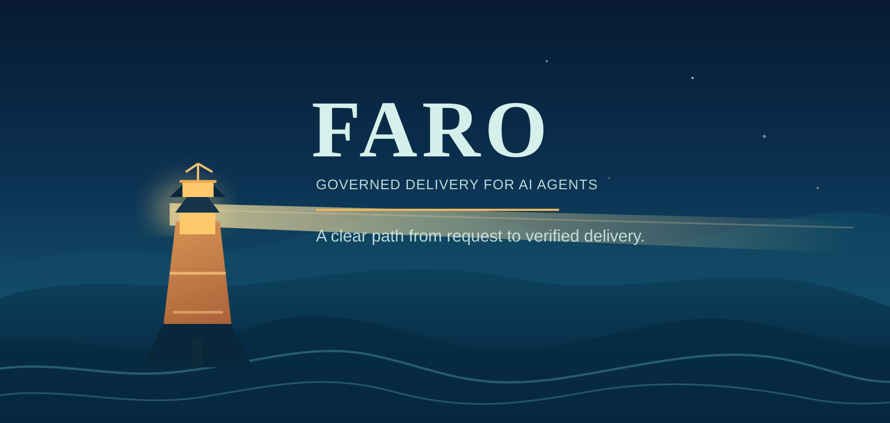

<p align="center">
  
</p>

<h1 align="center">FARO Suite Skills</h1>

<p align="center">
  A governed path from request to verified delivery for AI agents.
</p>

<p align="center">
  <strong>23 skills</strong> · Complete lifecycle · Integrity checked · Agent-portable
</p>

---

## Why FARO

AI agents can write code quickly. FARO gives that work a clear operating path: establish context, formalize the request, inspect the real codebase, plan, implement, test, validate, and deliver with evidence.

It is designed for teams that want an agent to move autonomously without losing traceability, scope control, or a clear human approval boundary.

| FARO provides | So your agent can |
| --- | --- |
| A single entry point | Route work to the right specialist instead of improvising phases |
| Explicit project contracts | Know what is observed, authorized, pending, or out of scope |
| Requirements-to-delivery traceability | Keep decisions, plans, QA evidence, and validation connected |
| Controlled handoffs | Move forward only when the current phase is genuinely complete |
| A portable skill suite | Run the same delivery discipline across compatible agents |

## The path

```text
Request → Context → Requirements → Technical plan → Build → QA → Validation → Delivery
```

FARO does not collapse those stages into paperwork. Each specialist skill exists to make one transition clear, evidence-based, and reversible when the facts do not support moving forward.

## Ask an agent to install FARO

The user does **not** need to clone this repository first. Give an agent the bootstrap skill and either a FARO repository URL or a local source. The agent obtains the suite into temporary staging, validates it, and installs it.

Provide an explicit tag or commit for a reproducible installation. With only a repository URL, the bootstrap selects the newest published stable `vMAJOR.MINOR.PATCH` tag by numeric version and reports its immutable commit. It does not install the default branch or prereleases implicitly. If no stable tag is published, installation stops.

```text
Load and execute this bootstrap skill:
https://raw.githubusercontent.com/matgro/faro-suite-skills/<tag-or-commit>/bootstrap/SKILL.md

Install FARO from this repository:
https://github.com/matgro/faro-suite-skills

Use the target agent's configured skills directory. If FARO is already installed,
show me the destination and comparison, then ask before replacing it.
```

If the bootstrap was supplied as a local file, give the agent the local path instead. If it cannot safely identify the package repository from the bootstrap URL, also provide the repository URL explicitly.

The bootstrap skill installs the complete `faro/` tree. It may retrieve the declared package source, but it must never execute a downloaded script. When an existing installation is found, it must inspect it, compare it with the incoming release, and obtain explicit user confirmation before replacement.

To update, ask the agent to run the bootstrap and update FARO. Without an explicit revision or new source, it uses the installed suite's provenance repository and selects its newest published stable tag. An identical installation is left unchanged; local modifications are reported before replacement, and a newer installed version is never downgraded implicitly. Explicit tags, commits and local sources remain pinned to the requested source.

> There is no universal skill directory. FARO intentionally lets the target agent determine its own configured skills root instead of assuming a vendor-specific path.

### Manual installation

Copy the complete `faro/` directory into the target agent's skills root, preserving every nested path:

```text
<agent-skills-root>/faro/
├── SKILL.md
├── faro-inicializacion/
├── faro-doctor/
├── faro-req-ingenieria/
├── faro-qa-ejecucion/
└── ...
```

Do not install only `faro/SKILL.md`. FARO routes work to its specialist skills and several of them depend on templates, references, assets, and validation scripts.

## What is included

```text
faro/                         Runtime suite
├── SKILL.md                  Router and lifecycle contract
├── faro-inicializacion/      Safe project contract initialization
├── faro-doctor/              Read-only workspace diagnosis
├── faro-arq-*/               Evidence-based architecture routes
├── faro-req-*/               Requirements, analysis, implementation, validation
├── faro-qa-ejecucion/        QA cases and evidence
├── faro-incidentes/          Incident intake, governed investigation and disposition
├── faro-ux/                  Visible-flow and interface design
├── faro-entrega/             Explicit commit, PR, release, and deployment handoff
├── faro-int-jira/            Optional governed Jira integration
├── faro-int-azure-devops/    Optional governed Azure DevOps integration
└── azure-devops-rest-v7/     Azure DevOps REST v7.1 capability

bootstrap/SKILL.md            Agent-guided installation and safe update
manifest.json                 Suite contract and complete skill inventory
checksums.sha256              SHA-256 integrity inventory for the runtime tree
CHANGELOG.md                  Release changes and safe update instructions
faro/references/suite-changelog.json  Distributed rename history for diagnostics
tests/validate_package.py     Dependency-free package validator
```

## Verify a release

Validate the repository before distribution:

```bash
python3 tests/validate_package.py
```

Validate an installed copy against the release:

```bash
python3 tests/validate_package.py --installed-at /path/to/your-agent/skills/faro
```

The validator checks the runtime skills, package manifest, bootstrap contract, file inventory, SHA-256 checksums, common secret patterns, name/folder consistency, internal references, and the distributed changelog. Shared read-only checks live in `faro/scripts/suite_validation.py` and are also used by doctor and the initialization preflight.

### Update compatibility and changelog

Read [CHANGELOG.md](CHANGELOG.md) before replacing a suite. The incoming `faro/references/suite-changelog.json` travels with the installation and records renamed skills for tooling. Bootstrap must report the affected changes, compare the complete trees and obtain explicit replacement confirmation; it must not overlay new files onto the old installation or migrate project files implicitly.

The pending package `1.3.0` renames the development route to `faro-req-desarrollo`. Its workspace contract remains `1.13.0`: package updates do not require reinitializing projects. After refreshing the runtime, run doctor on each workspace you resume. A retired `nextRoute` is reported with the current destination and requires an explicitly authorized, targeted correction that preserves requirement versions, scope, approvals and history.

Before publishing a new release, synchronize package version, provenance tag and changelog, then regenerate the inventory with `python tools/update_checksums.py` and run:

```bash
python -B -m unittest discover -s tests -p 'test_*.py'
python tests/validate_package.py
python -B faro/scripts/verify-routing.py
```

On Windows, keep the runtime's LF line endings declared by `.gitattributes`. When preparing a new release from an older CRLF checkout, `python tools/update_checksums.py --normalize-line-endings` performs the explicit conversion before calculating hashes. Never normalize an installed or published release to bypass verification. Retrieve releases with `git -c core.autocrlf=false clone ...`.

Changing local files does not publish a release: remote installation and origin verification require the new commit and matching immutable tag to be published. Never reuse the previous tag for a changed tree.

## Incidents are not automatically bugs

`faro-incidentes` records a reported symptom as `INC`, preserves evidence and hypotheses, and separates diagnosis, impact recovery and corrective work. A confirmed defect can lead to an explicitly authorized BUG; a changed business expectation leads to RM, while provider issues, valid business rules or operational causes can conclude without a software fix. Inconclusive evidence is not proof that no bug exists.

The incident directory `context/incidents/` and its index are created only when needed in an available workspace; existing workspaces do not require reinitialization or a contract-version migration. Known QA failures against documented acceptance criteria can still create a BUG directly.

FARO orchestrates rather than reimplements debugging: `systematic-debugging` from `obra/superpowers` supports technical investigation, and `incident-postmortem` from `github/awesome-copilot` supports a proportionate incident review. Reviewed commits, required-file/license hashes and scope limits are in `faro/references/incident-external-skills.json` and `faro/faro-incidentes/references/capacidades-externas.md`. These external skills are not bundled or implicitly installed. Bootstrap requests authorization, preserves same-name local customizations, and verifies complete pinned skills and security audit. Missing or blocked skills leave the applicable stage explicitly blocked, not silently replaced. Investigation never authorizes a fix or deployment.

## Editable development guidelines

Development loads its rules from these files inside `faro/faro-req-desarrollo/`:

- `references/lineamientos-comunes.md`: shared rules, including readability, naming, responsibilities, errors, configuration, minimal refactoring and TDD.
- `references/lineamientos-dotnet.md`: .NET/C# rules adapted from the supplied NZT sources; applied only to an evidenced .NET component.
- `references/lineamientos-blazor.md`: Blazor guidance adapted from reviewed NZT sources, read alongside common and .NET rules only for evidenced Blazor work. Covers components, forms, rendering modes, prerendered state and measured performance without installing NZT or imposing a new architecture.
- `references/lineamientos-laravel.md`: Laravel rules; applied only to an evidenced Laravel component.

Edit the Markdown rules directly; changing their text does not require editing `SKILL.md`. The agent rereads the common file plus the applicable technology file before each development unit. Mixed workspaces use the appropriate rules per component; other technologies use the common rules and the project's own instructions. Missing or empty selected guides block development instead of being silently ignored.

These are suite-wide defaults, not project-specific approvals. Explicit repository instructions and approved architecture take precedence; they never expand the authorized requirement. The agent may change the guidelines only when requested, not to bypass a rule it failed to follow.

Editing an installed guide is an intentional local customization and changes its release hash. Local coherence checks allow edited wording, while full origin verification still reports that the bytes differ from the published release. Before updating FARO, compare and preserve or explicitly agree how to reapply these edits; never overwrite them silently or regenerate installed hashes to conceal a difference.

## Hermes Agent location

For Hermes Agent, the active profile normally stores skills in `$HERMES_HOME/skills`, with `~/.hermes/skills` as the default-profile fallback:

```text
${HERMES_HOME:-$HOME/.hermes}/skills/faro/
```

The runtime may require a new session or a skill-index refresh before it discovers a newly copied suite.

## Release and security policy

Use a tagged release or pinned commit. When updating an existing installation, compare first and replace the entire `<skills-root>/faro/` tree only after explicit user approval. This avoids a mixed suite assembled from different releases.

Every release carries `faro/references/suite-provenance.json`, which names the source repository and an immutable release tag. For a full workspace diagnosis, run `faro-doctor` with `--verify-suite-origin`; it resolves that tag, fetches the referenced revision temporarily, and compares the installed tree byte-for-byte with its published `checksums.sha256`.

Do not add API keys, tokens, passwords, private certificates, cookies, `.env` files, client data, or production exports. See [SECURITY.md](SECURITY.md) for the full policy.

## License

MIT — see [LICENSE](LICENSE).
