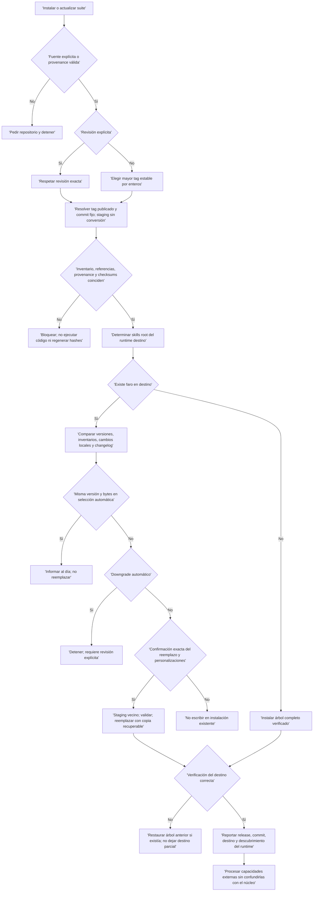
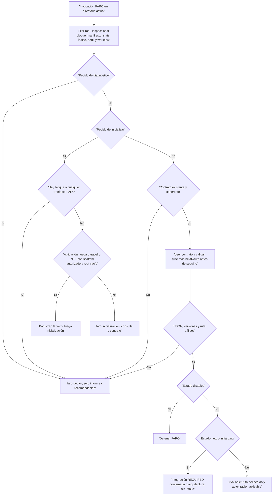
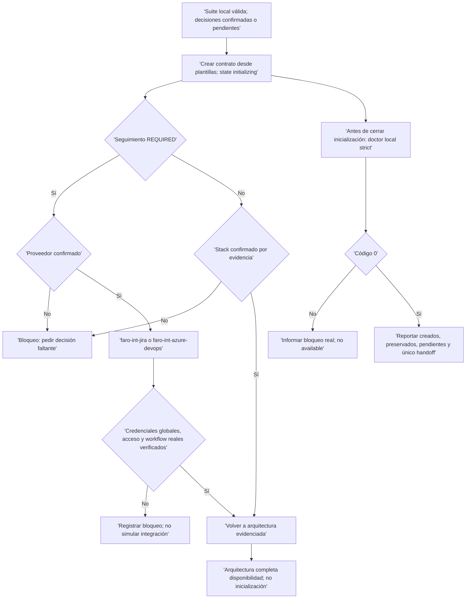
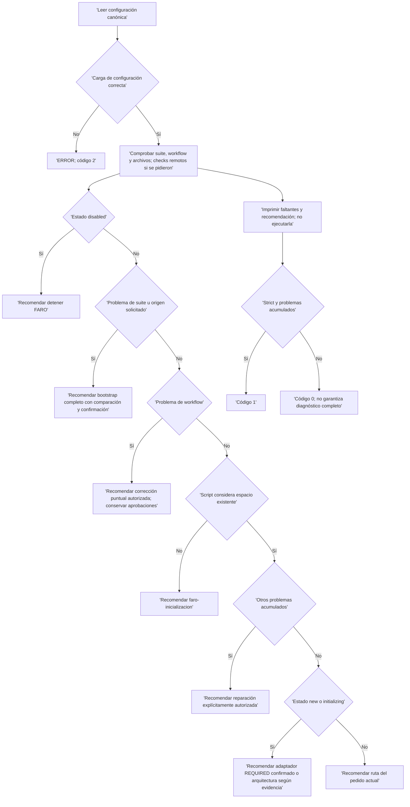

# 01 · Inicio, instalación y doctor

[Índice del flujo](README.md) · [Arquitectura y decisiones](02-arquitectura-y-decisiones.md)

## Qué representa este flujo

Son instrucciones que interpreta y ejecuta un agente, no un motor que dispare todas las ramas automáticamente. El router `faro` identifica el contexto y entrega una única ruta especialista; los handoffs siguientes son decisiones guiadas, no una cadena de scripts implícita. Esta página describe las fuentes del repositorio: paquete `1.6.0`, contrato canónico `1.13.0`. Son versiones independientes; tampoco se confunden con el `version` de cada skill.

Hay tres operaciones distintas:

| Operación | Responsable | Destino y resultado |
| --- | --- | --- |
| Instalar o actualizar la **suite de skills** | `bootstrap/SKILL.md`, nombre `faro-bootstrap` | Árbol completo `<skills-root>/faro/`; no inicializa ni migra proyectos. |
| Crear una **aplicación nueva** | `faro-bootstrap-dotnet` o `faro-bootstrap-laravel` | Scaffold técnico en root vacío confirmado; véase [página 02](02-arquitectura-y-decisiones.md). |
| Inicializar el **workspace FARO** | `faro-inicializacion` | Contrato documental en el root coordinador, estado `initializing`; arquitectura habilita después `available`. |

## 1. Bootstrap de la suite: de dónde sale y qué puede reemplazar

### Selección de fuente y release

1. Obtener fuente explícita: directorio local, repositorio o repositorio con release/tag/commit. Una URL del bootstrap sólo permite derivar el repositorio si lo codifica inequívocamente; si no, preguntar. No inventar una fuente.
2. En actualización sin fuente nueva, reutilizar y anunciar el repositorio de la provenance instalada; si falta o es inválida, pedirlo.
3. Respetar una revisión explícita sin sustituirla por otra. Sin revisión, listar tags remotos y seleccionar el estable numéricamente mayor: `refs/tags/vMAJOR.MINOR.PATCH`, componentes enteros sin ceros iniciales salvo cero. Excluir prereleases, sufijos de build y entradas peeled como candidatas. No ordenar alfabéticamente ni por fecha.
4. Resolver el tag al commit exacto, usando el peeled commit para tags anotados; fijarlo durante staging. Sin tag estable, fallo remoto, release inválida o tag que cambia durante la recuperación: detener. No caer a HEAD, otra versión antigua o la instalada.
5. Recuperar en staging temporal preservando bytes y finales de línea; para Git, desactivar `core.autocrlf`. Lo descargado es dato: no ejecutar scripts, hooks, instaladores ni binarios.



### Integridad y reemplazo

Antes de instalar se leen `manifest.json`, `checksums.sha256`, provenance, changelog y árbol `faro/`. El manifiesto debe nombrar el paquete, declarar `faro` como entrada y enumerar una vez cada skill real; carpeta y nombre del frontmatter deben concordar. Catálogo, rutas internas, referencias y handoffs deben resolver; las capacidades externas no se convierten en skills distribuidas. La primera release del changelog coincide con la versión del paquete; los renombres no tienen ciclos, terminan en skills presentes y sus nombres retirados están ausentes.

La provenance debe identificar el mismo repositorio y un `refs/tags/v*` acorde con la versión. Incluso una fuente local o commit explícito debe coincidir con su tag publicado y checksums. No normalizar archivos, regenerar hashes ni mover un tag para hacer pasar la validación. Estas son comprobaciones de datos, no permiso para ejecutar validadores descargados.

Si existe una instalación, informar diferencias de archivos y skills, versión de paquete separada del contrato, revisión entrante, modificaciones locales y changelog aplicable. Si la versión instalada es desconocida, no inventar el rango de migración. Pedir confirmación que nombre el destino y el reemplazo completo; acordar copia recuperable/reaplicación/descarte de lineamientos personalizados. Una solicitud de actualizar no reemplaza esa confirmación.

No copiar skills sueltas, superponer árboles ni dejar carpetas retiradas. Verificar primero la release intacta; una personalización posterior requiere autorización separada y se reporta como suite modificada. Ante fallo de reemplazo o verificación, restaurar la instalación anterior. Al finalizar, comprobar faltantes y extras, inventario y hashes en el destino; informar si hace falta reiniciar o refrescar el índice y no afirmar descubrimiento inmediato sin evidencia. Limpiar staging tras éxito salvo pedido de conservarlo.

### Skills externas: instalación no significa disponibilidad acreditada

| Grupo | Procedimiento declarado | Bloqueo y límite |
| --- | --- | --- |
| Laravel | Tras verificar FARO, procesar el catálogo. En Hermes, instalar URLs directas con `hermes skills install <url> --yes`; para árbol de repositorio, inspeccionar y enumerar entradas del subárbol declarado; auditar cada instalación. | No ejecutar scripts upstream ni usar `--force`. En runtime no Hermes, informar estas capacidades como no disponibles en vez de copiarlas manualmente. El catálogo por sí solo no prueba instalación, habilitación o seguridad. |
| Actualización Laravel | Primero `hermes skills check <name>`; sólo tras autorización explícita, `update` y después `audit`. | Doctor sólo comprueba; no instala ni actualiza. |
| Incidentes | Proponer directorios fijados por commit, pedir autorización de instalación/reemplazo, conservar auxiliares y licencia mediante instalador documentado; comparar `requiredFiles`, hashes, origen y auditoría en destino. | No reemplazar una skill local homónima sin confirmación, instalar sólo el `SKILL.md`, cambiar el pin a main/latest ni eludir el escáner. Si el runtime no preserva el directorio completo, bloquear esa etapa externa sin deshacer el núcleo FARO ya verificado. |

Instalar la suite **no migra ningún workspace**. Cada proyecto que se reanude debe diagnosticarse con doctor. Un renombre documentado no es un alias ejecutable ni permiso para editar `nextRoute`; se propone corrección puntual autorizada conservando IDs, versiones, aprobaciones e historia.

## 2. Entrada al workspace: primero root y existencia

El root coordinador es el directorio de trabajo de la sesión. Sólo una instrucción humana explícita lo cambia. Una ruta aportada como código, documentación o evidencia se indexa: no pasa a ser root ni recibe contratos FARO. No tomar control de un directorio ajeno sin invocación FARO.

Antes de inspeccionar fuentes externas, comprobar `AGENTS.md`, delimitadores FARO, manifiesto, stats, índice, perfil y workflow opcional. Distinguir:

- **Ausente:** no hay bloque ni artefactos FARO. Un `AGENTS.md` ajeno no autoriza borrar su contenido.
- **Existente completo:** están los artefactos y son coherentes; no equivale por sí solo a `available`.
- **Existente parcial:** basta cualquier bloque o artefacto FARO, aunque falten otros o el estado sea `new`/`initializing`. No volver a inicializar silenciosamente.



Para reanudar se ejecuta `python -B <skills-root>/faro/scripts/suite_validation.py --workflow <root>/context/workflow.json`. JSON malformado, ruta desconocida/retirada o suite incoherente van a doctor; no descartar, traducir ni recrear el workflow. Una versión de contrato anterior sólo se migra con autorización; una posterior nunca se degrada. En `new`/`initializing` no se reciben SOL/RM/BUG/TEC/INC.

## 3. Inicialización: qué observa, qué pregunta y qué escribe

### Consulta agrupada

Primero validar la suite local con `suite_validation.py` y exigir código 0; después inspeccionar instrucciones, Git y manifests/locks sin leer secretos. Hacer **una consulta agrupada**, no un interrogatorio reiterado:

| Decisión | Observar antes de preguntar | Si falta confirmación |
| --- | --- | --- |
| Identidad, tipo existente/nuevo/otro y stack | Instrucciones, manifests y código accesible | Preguntar lo no verificable; no imponer stack. |
| Repositorios y fuentes | Root y rutas aportadas/indexables | Confirmar inventario y propósito; dejar pendientes explícitos. |
| Seguimiento | Perfil si existe durante reparación autorizada | Confirmar `OFF` o `REQUIRED`; nunca activarlo por existir una credencial. |
| Proveedor | Decisión humana | `JIRA` o `AZURE_DEVOPS` con `REQUIRED`; no asumirlo por una URL sin confirmar. |
| Documentación funcional | Decisión humana | `HABILITADA` o `DESHABILITADA`. |

La skill de inicialización prescribe proponer para Jira `https://matgro.atlassian.net` y la clave `LPK`: son propuestas codificadas, no valores universales ni confirmación de que ese proyecto sea el del usuario. Deben confirmarse antes de usarse. Para Azure DevOps pedir organización, proyecto, área y equipo; una URL de proyecto puede descomponerse sólo como propuesta. Valores globales no sensibles del agente pueden proponerse, pero requieren confirmación y verificación remota antes de convertirse en configuración del proyecto. Toda decisión faltante queda `PENDIENTE`, nunca inventada.

Si se declara Laravel nuevo sin `composer.json`, o .NET nuevo sin `.sln`/`.csproj`, no escribir aún el contrato: entregar al bootstrap técnico con root vacío y autorización. Para .NET confirmar plantilla exacta; si el scaffold existe, no repetirlo. [Detalle y bloqueos](02-arquitectura-y-decisiones.md#1-scaffold-técnico-antes-del-contrato).

### Escrituras autorizadas por la configuración canónica

| Artefacto | Plantilla | Qué conserva o registra |
| --- | --- | --- |
| `AGENTS.md` | `templates/AGENTS.md` | Sólo administrar bloque FARO estándar; preservar contenido externo. |
| `context/faro-workspace.json` | `templates/faro-workspace-manifest.json` | Versión, `contractSource` y `managedArtifacts`; no copia ni redefine la política central. |
| `context/stats.json` | `templates/stats.json` | Identidad, repositorios, `faro.version` y `contractVersion` canónicos; pasar de plantilla `new` a `initializing`, salvo desactivación explícita. |
| `context/README.md` | `templates/context-README.md` | Ubicación, descripción y propósito del código, docs y fuentes. Mantener sección de fuentes incluso si no hay registradas. |
| `context/requirements/project-profile.md` | `templates/project-profile.md` | Seguimiento, proveedor, metadatos confirmados y DF; nunca secretos. |
| `context/workflow.json`, **condicional** | `templates/workflow.json` | Sólo unidad activa que requiere continuidad; no se crea por defecto. |

Crear también los directorios obligatorios `context/` y `context/requirements/`. No crear por inicialización carpetas ADR/RFC, incidentes, RM o DF ficticios. Sustituir marcadores por hechos o respuestas; no convertir valores de plantilla en hechos remotos. La norma central es `faro/templates/faro-workspace-config.json`, no el manifiesto local.

### Handoff y cierre de inicialización



La rama no `REQUIRED` incluye `OFF` o seguimiento pendiente: puede seleccionarse arquitectura si hay evidencia, pero no inventar una política ni declarar disponibilidad como sustituto de decisiones pendientes. Las integraciones no repiten la consulta agrupada: verifican credenciales globales del agente, acceso y mapeos reales. Sin credenciales no consultan ni modifican el servicio; con `REQUIRED` no simulan seguimiento manual. Jira exige PENDING/DOING/DONE; ausencia de CANCELLED bloquea sólo cancelaciones. Azure DevOps verifica tipos, áreas, equipo/iteraciones y campos configurados. Esos chequeos remotos de seguimiento son del adaptador, **no de `doctor.py`**.

Antes de cerrar la inicialización ejecutar doctor con `--root <root> --strict` y exigir 0. Es un control local, no acredita origen remoto. La transición a `available` corresponde a arquitectura, con índice/proyecto/repositorios/arquitectura verificables. El workflow conserva unidad, fase, autorización exacta, `waitingOn` y `nextRoute`; no reemplaza RM, plan ni tareas y sólo puede haber una unidad `doing`.

## 4. Doctor: política, implementación y resultado

### Dos niveles de ejecución

Comandos de referencia de las fuentes, no ejecutados por leer esta guía:

```text
python -B <skills-root>/faro/faro-doctor/scripts/doctor.py --root <root> --strict
python -B <skills-root>/faro/faro-doctor/scripts/doctor.py --root <root> --verify-suite-origin --strict
python -B <skills-root>/faro/faro-doctor/scripts/doctor.py --root <root> --verify-suite-origin --check-external-skills --strict
```

Usar el intérprete disponible. La skill muestra `python3`; no asumir que ese alias exista. El diagnóstico **completo** exige `--verify-suite-origin`; sin él el propio script imprime «no comprobado». `--check-external-skills` es opcional y sólo consulta Laravel.

| Nivel | Qué hace realmente |
| --- | --- |
| Local de suite | `validate_suite`: inventario de SKILL, nombre/carpeta, duplicados, catálogo del router, referencias internas reconocidas y enlaces `references/`, changelog/provenance, renombres y destinos. Si existe `faro-incidentes`, valida estructura del catálogo externo de incidentes, pins, rutas seguras, roles, licencia y formato de hashes; **no** acredita instalación externa ni seguridad upstream. |
| Local de continuidad | `validate_workflow`: ausencia aceptada, JSON objeto y `nextRoute` null o nombre vigente; detecta renombres y propone destino, sin escribir. No valida todo el esquema/semántica del workflow. |
| Local de workspace | Recorre `requiredFiles`, parsea JSON, cuenta delimitadores FARO, compara versión/origen/lista exacta y ordenada de artefactos del manifiesto, compara `stats.contractVersion`; imprime estado/proyecto/versión FARO y valores de perfil por regex. |
| Remoto de origen, opt-in | Resuelve tag de provenance y peeled commit mediante Git, obtiene commit en checkout temporal con conversión desactivada, lee checksums publicados y compara conjunto de archivos y SHA-256 instalado. Informa verificado, no verificable o no coincide. No escribe en el workspace, aunque sí usa staging temporal y red. |
| Externas Laravel, opt-in | Por nombre del catálogo, ejecuta `hermes skills check`; salida con `up_to_date` → actual; fallo/ausencia reconocida → no verificable; otras salidas exitosas → actualización disponible. No instala, actualiza ni audita. |

### Prioridad real de la recomendación del script



El informe debe separar existencia, root, versión esperada/instalada/paquete, compatibilidad, coherencia local, procedencia, archivos, identidad/estado, arquitectura, perfil, workflow, bloqueos y recomendación. No afirmar que no existe en el proyecto lo que sólo está «no encontrado en el contrato» o «no indexado».

### Límites y discrepancias observadas, no corregidas

Estas diferencias exigen interpretación del agente; no se presentan como capacidades que el script ya implemente:

1. **Detección de existencia más amplia:** `doctor.py` considera existente cualquier `AGENTS.md`, incluso ajeno sin bloque FARO, o archivos requeridos de contexto. El router distingue bloque/artefactos FARO; además un `context/` vacío no basta para la condición exacta del script. Informar evidencia, no borrar ni adoptar contenido ajeno.
2. **Delimitadores no equivalen a plantilla:** el script cuenta un START y un END; no compara el bloque con la plantilla ni verifica su orden. La skill pide comprobar bloque estándar y preservar contenido externo.
3. **Validación semántica limitada:** no comprueba `requiredDirectories` de forma independiente, esquema completo, identidad obligatoria, repositorios indexados, `supportedStates`, `schemaVersion`, validez de `updatedAt`, igualdad de `faro.version` o coherencia semántica del perfil. Imprimirlos o parsear JSON no los valida. Algunos tipos JSON inesperados pueden producir excepción; no prometer un informe estructurado para toda corrupción posible.
4. **Omisión .NET:** la búsqueda de arquitectura sólo incluye Laravel, móvil y genérica; omite `context/architecture-dotnet.md`. La recomendación textual de arquitectura también omite `faro-arq-dotnet`. El router y la skill .NET sí la reconocen: no redirigir un .NET a genérica por esa omisión.
5. **Provenance no es comprobar novedades de la suite:** `--verify-suite-origin` coteja el tag declarado, no busca el estable más nuevo. `--check-external-skills` no audita seguridad ni pins, no prueba directorios externos de incidentes y clasifica por texto del CLI. Sus problemas se agregan al grupo general: pueden acabar en recomendación genérica de reparación del workspace, aunque la política indica mantenimiento externo autorizado vía bootstrap.
6. **Strict no certifica disponibilidad:** un estado desconocido, identidad pendiente, arquitectura ausente o seguimiento no verificado pueden no agregar problemas. El código 0 local no habilita `available`, no acredita QA ni verifica servicios Jira/Azure DevOps. Sin flags remotos, tampoco acredita procedencia o externas.
7. **Redacción de inicialización ambigua:** su apartado «Cuándo usar» menciona `new`/`initializing`, pero el límite explícito y el router envían una inicialización repetida con cualquier artefacto existente a doctor. Reparación sólo después del diagnóstico y autorización específica; no reutilizar esa frase para sobrescribir.

Doctor nunca repara, migra, cambia estado ni ejecuta su siguiente ruta. No borrar JSON malformado, recrear workflows, leer `.env` ni revelar secretos. Una reparación o migración posterior es otra acción autorizada; un renombre autorizado cambia sólo `nextRoute`, preserva el resto y vuelve a verificar.

## Fuentes del repositorio

| Tema | Fuente relativa |
| --- | --- |
| Instalación, staging, tags, reemplazo y externas | [Bootstrap de suite](../../bootstrap/SKILL.md) |
| Root, existencia, estados y handoffs | [Router FARO](../../faro/SKILL.md), [casos de ruteo](../../faro/references/routing-cases.md) |
| Inicialización y consulta agrupada | [Skill de inicialización](../../faro/faro-inicializacion/SKILL.md) |
| Política doctor y ejecución real completa | [Skill doctor](../../faro/faro-doctor/SKILL.md), [doctor.py](../../faro/faro-doctor/scripts/doctor.py), [suite_validation.py](../../faro/scripts/suite_validation.py) |
| Política canónica | [Configuración](../../faro/templates/faro-workspace-config.json) |
| Plantillas de contrato | [AGENTS](../../faro/templates/AGENTS.md), [manifiesto](../../faro/templates/faro-workspace-manifest.json), [stats](../../faro/templates/stats.json), [índice](../../faro/templates/context-README.md), [perfil](../../faro/templates/project-profile.md), [workflow](../../faro/templates/workflow.json) |
| Seguimiento inicial | [Jira](../../faro/faro-int-jira/SKILL.md), [Azure DevOps](../../faro/faro-int-azure-devops/SKILL.md) |
| Versiones y procedencia | [Provenance](../../faro/references/suite-provenance.json), [changelog](../../faro/references/suite-changelog.json) |
| Capabilities auxiliares | [Catálogo Laravel](../../faro/references/laravel-external-skills.json), [catálogo incidentes](../../faro/references/incident-external-skills.json), [restricciones y disponibilidad](../../faro/faro-incidentes/references/capacidades-externas.md) |

Continuación: [scaffold, arquitectura, ADR y RFC](02-arquitectura-y-decisiones.md). Volver al [árbol central e índice](README.md).
