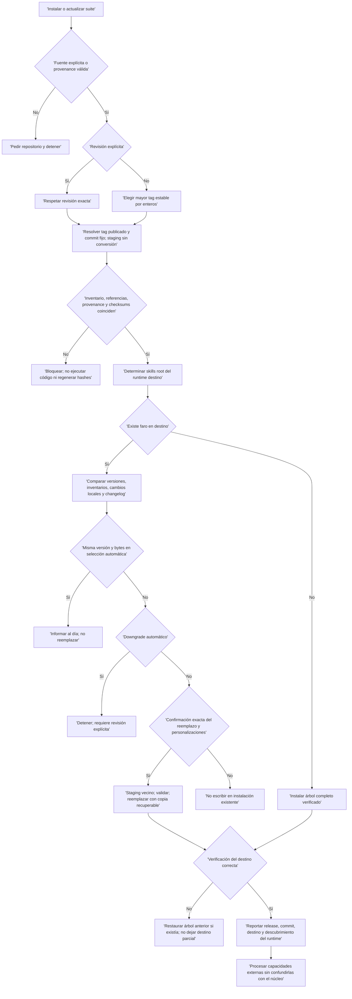
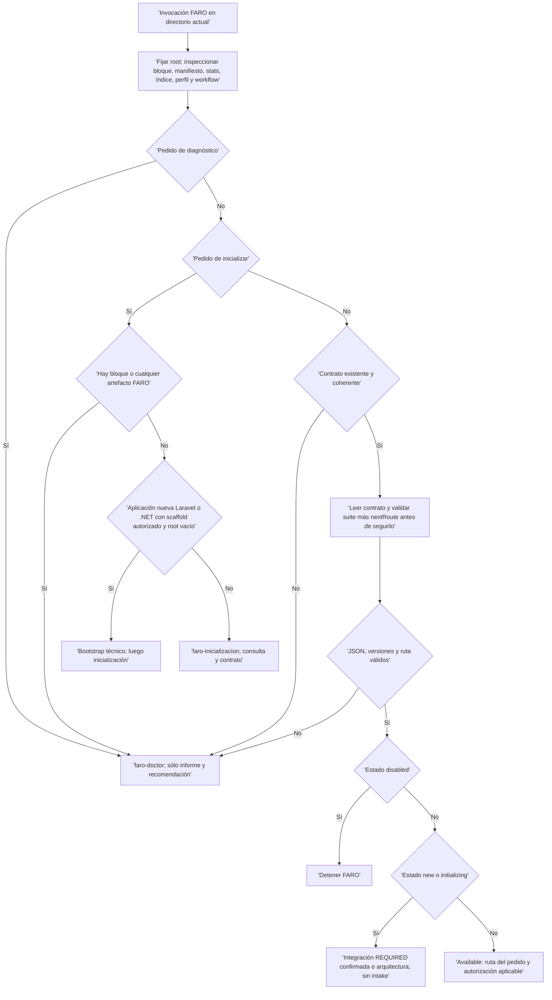
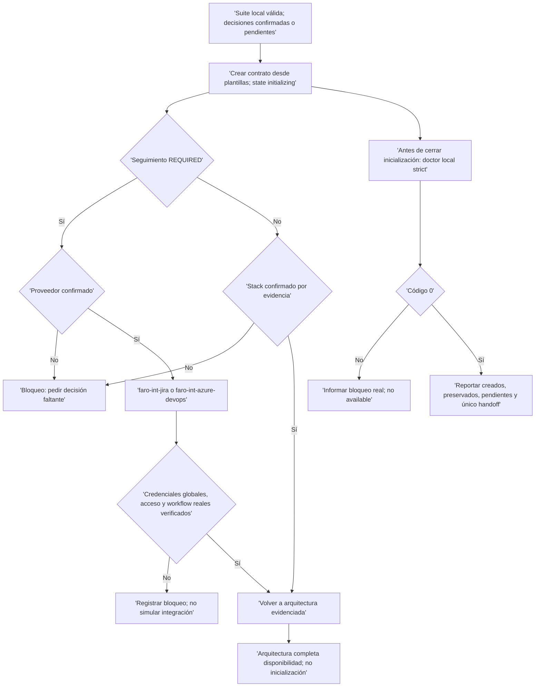
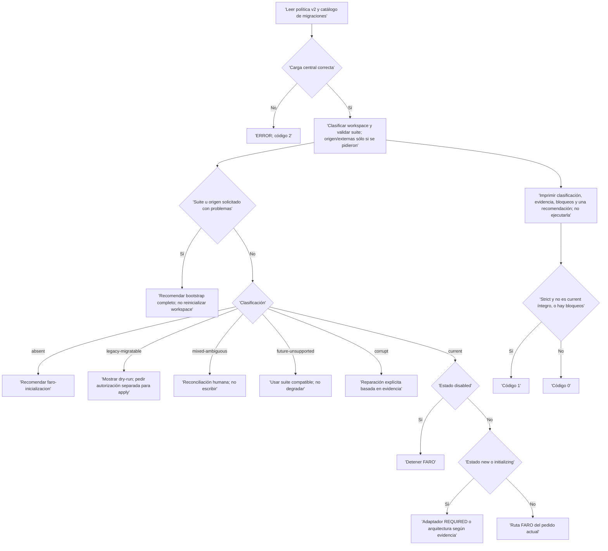

# 01 · Inicio, instalación y doctor

[Índice del flujo](README.md) · [Arquitectura y decisiones](02-arquitectura-y-decisiones.md)

## Qué representa este flujo

Son instrucciones que interpreta y ejecuta un agente, no un motor que dispare todas las ramas automáticamente. El router `faro` identifica el contexto y entrega una única ruta especialista; los handoffs siguientes son decisiones guiadas, no una cadena de scripts implícita. Esta página describe las fuentes del repositorio: paquete `2.0.0`, contrato canónico `2.0.0`. Son versiones independientes; tampoco se confunden con el `version` de cada skill.

Hay tres operaciones distintas:

| Operación | Responsable | Destino y resultado |
| --- | --- | --- |
| Instalar o actualizar la **suite de skills** | `bootstrap/SKILL.md`, nombre `faro-bootstrap` | Árbol completo `<skills-root>/faro/`; no inicializa ni migra proyectos. |
| Crear una **aplicación nueva** | `faro-bootstrap-dotnet` o `faro-bootstrap-laravel` | Scaffold técnico en root vacío confirmado; véase [página 02](02-arquitectura-y-decisiones.md). |
| Inicializar el **workspace FARO** | `faro-inicializacion` | Contrato documental en el root coordinador, estado `initializing`; arquitectura habilita después `available`. |

## 1. Bootstrap de la suite: de dónde sale y qué puede reemplazar

### Selección de fuente y release

1. Obtener fuente explícita: directorio local, repositorio o repositorio con release/tag/commit. Una URL del bootstrap sólo permite derivar el repositorio si lo codifica inequívocamente; si no, preguntar. No inventar una fuente.
2. En actualización sin fuente nueva, reutilizar y anunciar el repositorio de la provenance instalada; si falta o es inválida, pedirlo.
3. Respetar una revisión explícita sin sustituirla por otra. Sin revisión, listar tags remotos y seleccionar el estable numéricamente mayor: `refs/tags/vMAJOR.MINOR.PATCH`, componentes enteros sin ceros iniciales salvo cero. Excluir prereleases, sufijos de build y entradas peeled como candidatas. No ordenar alfabéticamente ni por fecha.
4. Resolver el tag al commit exacto, usando el peeled commit para tags anotados; fijarlo durante staging. Sin tag estable, fallo remoto, release inválida o tag que cambia durante la recuperación: detener. No caer a HEAD, otra versión antigua o la instalada.
5. Recuperar en staging temporal preservando bytes y finales de línea; para Git, desactivar `core.autocrlf`. Lo descargado es dato: no ejecutar scripts, hooks, instaladores ni binarios.



### Integridad y reemplazo

Antes de instalar se leen `manifest.json`, `checksums.sha256`, provenance, changelog y árbol `faro/`. El manifiesto debe nombrar el paquete, declarar `faro` como entrada y enumerar una vez cada skill real; carpeta y nombre del frontmatter deben concordar. Catálogo, rutas internas, referencias y handoffs deben resolver; las capacidades externas no se convierten en skills distribuidas. La primera release del changelog coincide con la versión del paquete; los renombres no tienen ciclos, terminan en skills presentes y sus nombres retirados están ausentes.

La provenance debe identificar el mismo repositorio y un `refs/tags/v*` acorde con la versión. Incluso una fuente local o commit explícito debe coincidir con su tag publicado y checksums. No normalizar archivos, regenerar hashes ni mover un tag para hacer pasar la validación. Estas son comprobaciones de datos, no permiso para ejecutar validadores descargados.

Si existe una instalación, informar diferencias de archivos y skills, versión de paquete separada del contrato, revisión entrante, modificaciones locales y changelog aplicable. Si la versión instalada es desconocida, no inventar el rango de migración. Pedir confirmación que nombre el destino y el reemplazo completo; acordar copia recuperable/reaplicación/descarte de lineamientos personalizados. Una solicitud de actualizar no reemplaza esa confirmación.

No copiar skills sueltas, superponer árboles ni dejar carpetas retiradas. Verificar primero la release intacta; una personalización posterior requiere autorización separada y se reporta como suite modificada. Ante fallo de reemplazo o verificación, restaurar la instalación anterior. Al finalizar, comprobar faltantes y extras, inventario y hashes en el destino; informar si hace falta reiniciar o refrescar el índice y no afirmar descubrimiento inmediato sin evidencia. Limpiar staging tras éxito salvo pedido de conservarlo.

### Skills externas: instalación no significa disponibilidad acreditada

| Grupo | Procedimiento declarado | Bloqueo y límite |
| --- | --- | --- |
| Laravel | Tras verificar FARO, procesar el catálogo. En Hermes, instalar URLs directas con `hermes skills install <url> --yes`; para árbol de repositorio, inspeccionar y enumerar entradas del subárbol declarado; auditar cada instalación. | No ejecutar scripts upstream ni usar `--force`. En runtime no Hermes, informar estas capacidades como no disponibles en vez de copiarlas manualmente. El catálogo por sí solo no prueba instalación, habilitación o seguridad. |
| Actualización Laravel | Primero `hermes skills check <name>`; sólo tras autorización explícita, `update` y después `audit`. | Doctor sólo comprueba; no instala ni actualiza. |
| Incidentes | Proponer directorios fijados por commit, pedir autorización de instalación/reemplazo, conservar auxiliares y licencia mediante instalador documentado; comparar `requiredFiles`, hashes, origen y auditoría en destino. | No reemplazar una skill local homónima sin confirmación, instalar sólo el `SKILL.md`, cambiar el pin a main/latest ni eludir el escáner. Si el runtime no preserva el directorio completo, bloquear esa etapa externa sin deshacer el núcleo FARO ya verificado. |

Instalar la suite **no migra ningún workspace**. Cada proyecto que se reanude debe diagnosticarse con doctor. `contract-migrations.json` sólo declara rutas soportadas: para `1.13.0` → `2.0.0` se revisa primero el dry-run y `--apply` requiere autorización explícita del workspace. Un renombre documentado no es un alias ejecutable ni permiso para editar `nextRoute`; se propone corrección puntual autorizada conservando IDs, versiones, aprobaciones e historia.

## 2. Entrada al workspace: primero root y existencia

El root coordinador es el directorio de trabajo de la sesión. Sólo una instrucción humana explícita lo cambia. Una ruta aportada como código, documentación o evidencia se indexa: no pasa a ser root ni recibe contratos FARO. No tomar control de un directorio ajeno sin invocación FARO.

Antes de inspeccionar fuentes externas, comprobar `AGENTS.md`, delimitadores FARO, manifiesto, stats, índice, perfil y workflow opcional. Distinguir:

- **Ausente:** no hay bloque ni artefactos FARO. Un `AGENTS.md` ajeno no autoriza borrar su contenido.
- **Current:** contrato `2.0.0`, estructura/catálogos coherentes y sin mezcla; no equivale por sí solo a `available`.
- **Legacy-migratable:** contrato `1.13.0` reconocible y sin colisiones con v2; sólo diagnóstico y plan de migración.
- **Mixed-ambiguous / corrupt:** layouts duplicados, IDs/rutas ambiguos o artefactos inválidos; no escribir hasta decisión/reparación explícita.
- **Future-unsupported:** contrato posterior al soportado; nunca degradar.



Para reanudar se ejecuta `python -B <skills-root>/faro/scripts/suite_validation.py --workflow <root>/context/workflow.json`. JSON malformado, ruta desconocida/retirada o suite incoherente van a doctor; no descartar, traducir ni recrear el workflow. Una versión de contrato anterior sólo se migra con autorización; una posterior nunca se degrada. En `new`/`initializing` no se reciben SOL/RM/BUG/TEC/INC.

### Glosario condicional y política de aplicaciones existentes

Tras confirmar root y estado, leer el `context/glossary.md` del coordinador antes de interpretar vocabulario, incluso al reanudar o entrar directamente a una especialista. `disabled` detiene FARO; sin contrato no crear `context/` para guardar términos. En bootstrap conservar el destino vacío y pasar definiciones a inicialización.

Crear el glosario desde su plantilla sólo con conocimiento útil `CONFIRMADA` u `OBSERVADA`, fuente y escritura documental permitida; indexarlo una vez en `context/README.md`. Conservar `PENDIENTE`/`NO DEFINIDO` y `CONFLICTO` sin presentar hipótesis como hechos. Preservar grafía, ámbito y correcciones con historial. No inferir siglas ni fusionar significados de módulos distintos. Si nada cambió, no escribir ni refrescar fechas.

Doctor y consultas de sólo lectura no escriben glosario ni índice. Su ausencia no es defecto: no reinicializar ni cambiar `contractVersion`, `managedArtifacts`, estado o aprobaciones para adoptarlo. Una definición no crea RM, BUG, TEC, issue ni workflow ni renombra código.

En aplicaciones existentes, la ausencia de política de versiones es una decisión pendiente, no licencia para aplicar defaults. Arquitectura descubre fuente y lectores sin leer ni escribir `.env`; propone la sección **Versionado de aplicaciones** del perfil, no un archivo obligatorio nuevo. Doctor informa el faltante sin instalar mecanismos, cambiar valores ni reparar por inferencia. Su ausencia no bloquea inicialización ni convierte un workspace válido en incompleto: resolver lo necesario antes de la primera entrega versionada. No hay incremento del contrato por esta política.

**Fuentes:** [glosario de dominio](../../faro/references/domain-glossary.md), [plantilla de glosario](../../faro/templates/glossary.md), [versionado de aplicaciones](../../faro/references/application-versioning.md), [decisión por arquitectura](02-arquitectura-y-decisiones.md#versionado-de-aplicaciones-por-componente).

## 3. Inicialización: qué observa, qué pregunta y qué escribe

### Consulta agrupada

Primero validar la suite local con `suite_validation.py` y exigir código 0; después inspeccionar instrucciones, Git y manifests/locks sin leer secretos. Hacer **una consulta agrupada**, no un interrogatorio reiterado:

| Decisión | Observar antes de preguntar | Si falta confirmación |
| --- | --- | --- |
| Identidad, tipo existente/nuevo/otro y stack | Instrucciones, manifests y código accesible | Preguntar lo no verificable; no imponer stack. |
| Repositorios y fuentes | Root y rutas aportadas/indexables | Confirmar inventario y propósito; dejar pendientes explícitos. |
| Seguimiento | Perfil si existe durante reparación autorizada | Confirmar `OFF` o `REQUIRED`; nunca activarlo por existir una credencial. |
| Proveedor | Decisión humana | `JIRA` o `AZURE_DEVOPS` con `REQUIRED`; no asumirlo por una URL sin confirmar. |
| Documentación funcional | Decisión humana | `HABILITADA` o `DESHABILITADA`. |

La skill de inicialización prescribe proponer para Jira `https://matgro.atlassian.net` y la clave `LPK`: son propuestas codificadas, no valores universales ni confirmación de que ese proyecto sea el del usuario. Deben confirmarse antes de usarse. Para Azure DevOps pedir organización, proyecto, área y equipo; una URL de proyecto puede descomponerse sólo como propuesta. Valores globales no sensibles del agente pueden proponerse, pero requieren confirmación y verificación remota antes de convertirse en configuración del proyecto. Toda decisión faltante queda `PENDIENTE`, nunca inventada.

Si se declara Laravel nuevo sin `composer.json`, o .NET nuevo sin `.sln`/`.csproj`, no escribir aún el contrato: entregar al bootstrap técnico con root vacío y autorización. Para .NET confirmar plantilla exacta; si el scaffold existe, no repetirlo. [Detalle y bloqueos](02-arquitectura-y-decisiones.md#1-scaffold-técnico-antes-del-contrato).

### Escrituras autorizadas por la configuración canónica

| Artefacto | Plantilla | Qué conserva o registra |
| --- | --- | --- |
| `AGENTS.md` | `templates/AGENTS.md` | Sólo administrar bloque FARO estándar; preservar contenido externo. |
| `context/faro-workspace.json` | `templates/faro-workspace-manifest.json` | Versión, `contractSource` y `managedArtifacts`; no copia ni redefine la política central. |
| `context/stats.json` | `templates/stats.json` | Identidad, repositorios, `contractVersion` estructural y `faro.version` del paquete que materializa el workspace; pasar de plantilla `new` a `initializing`, salvo desactivación explícita. |
| `context/README.md` | `templates/context-README.md` | Ubicación, descripción y propósito del código, docs y fuentes. Mantener sección de fuentes incluso si no hay registradas. |
| `context/requirements/project-profile.md` | `templates/project-profile.md` | Seguimiento, proveedor, metadatos confirmados y DF; nunca secretos. |
| `context/requirements/requirements-catalog.md` | `templates/requirements-catalog.md` | Reservas, localización, relaciones y referencia remota de RM/BUG/TEC; sin estado operativo. |
| `context/requirements/functional-documents-catalog.md` | `templates/functional-documents-catalog.md` | Reservas y localización de DF duraderos; no contiene expedientes. |
| `context/workflow.json`, **condicional** | `templates/workflow.json` | Sólo unidad activa que requiere continuidad; no se crea por defecto. |

Crear también `context/requirements/functional/` y `context/requirements/work-items/`, vacíos de unidades. No crear por inicialización carpetas ADR/RFC, incidentes ni expedientes RM/BUG/TEC/DF ficticios. Sustituir marcadores por hechos o respuestas; no convertir valores de plantilla en hechos remotos. La norma central es `faro/templates/faro-workspace-config.json`, no el manifiesto local.

### Handoff y cierre de inicialización



La rama no `REQUIRED` incluye `OFF` o seguimiento pendiente: puede seleccionar arquitectura y documentación sin unidad, pero no crear RM/BUG/TEC ni simular un gestor Markdown. Las integraciones no repiten la consulta agrupada: verifican credenciales globales del agente, acceso y mapeos por clase/tipo. Sin credenciales no consultan ni modifican el servicio; con `REQUIRED` no simulan seguimiento manual. Esos chequeos remotos son del adaptador, no de doctor salvo una lectura opt-in explícita.

Antes de cerrar la inicialización ejecutar doctor con `--root <root> --strict` y exigir 0. Es un control local, no acredita origen remoto. La transición a `available` corresponde a arquitectura, con índice/proyecto/repositorios/arquitectura verificables. El workflow conserva sólo ID/ruta activa, fase/checkpoint, autorización exacta, `waitingOn` y `nextRoute`; no conserva backlog, terminadas ni estado operativo.

## 4. Doctor: política, implementación y resultado

### Dos niveles de ejecución

Comandos de referencia de las fuentes, no ejecutados por leer esta guía:

```text
python -B <skills-root>/faro/faro-doctor/scripts/doctor.py --root <root> --strict
python -B <skills-root>/faro/faro-doctor/scripts/doctor.py --root <root> --verify-suite-origin --strict
python -B <skills-root>/faro/faro-doctor/scripts/doctor.py --root <root> --verify-suite-origin --check-external-skills --strict
```

Usar el intérprete disponible. La skill muestra `python3`; no asumir que ese alias exista. El diagnóstico **completo** exige `--verify-suite-origin`; sin él el propio script imprime «no comprobado». `--check-external-skills` es opcional y sólo consulta Laravel.

| Nivel | Qué hace realmente |
| --- | --- |
| Local de suite | `validate_suite`: inventario de skills, nombre/carpeta, duplicados, catálogo del router, referencias internas, changelog/provenance, renombres y catálogo de migraciones. Si existe `faro-incidentes`, valida la estructura declarativa de sus capacidades externas, pins, rutas seguras, roles, licencia y formato de hashes; **no** acredita instalación externa ni seguridad upstream. |
| Clasificación local | Fija el root sin seguir symlinks y distingue exactamente `absent`, `current`, `legacy-migratable`, `mixed-ambiguous`, `future-unsupported` o `corrupt`. Un `AGENTS.md` ajeno sin bloque ni otros artefactos FARO sigue siendo `absent`; un marcador parcial es corrupción. |
| Contrato v2 actual | Exige cuatro directorios y siete archivos regulares, bloque FARO equivalente a la plantilla, schemas/versiones, manifiesto y stats completos, perfil v2, metadatos y tablas de ambos catálogos, layout validado por el helper central y workflow v2 exacto si existe. Comprueba `updatedAt`, tipos, autorización, referencia al expediente o INC registrado, checkpoint/espera y ausencia de estado operativo incluso en claves anidadas. |
| Contrato legado | Reconoce sólo contratos origen declarados en `contract-migrations.json`, valida su forma en lectura y muestra el comando dry-run. Una mezcla de layouts/versiones bloquea; doctor nunca ejecuta `--apply`. |
| Remoto de origen, opt-in | Resuelve tag de provenance y peeled commit mediante Git, obtiene commit en checkout temporal con conversión desactivada, lee checksums publicados y compara conjunto de archivos y SHA-256 instalado. Informa verificado, no verificable o no coincide. No escribe en el workspace, aunque sí usa staging temporal y red. |
| Externas Laravel, opt-in | Por nombre del catálogo, ejecuta `hermes skills check`; salida con `up_to_date` → actual; fallo/ausencia reconocida → no verificable; otras salidas exitosas → actualización disponible. No instala, actualiza ni audita. |

### Prioridad real de la recomendación del script



El informe muestra una **matriz de versiones** antes de la recomendación: paquete de suite, skill principal, inventario de skills, contrato esperado/instalado, paquete que materializó el workspace y schema del workflow. La compatibilidad se evalúa sólo entre suite y contrato; el workflow es un checkpoint con schema, y las versiones de DF/RM/plan/QA/validación pertenecen a cada expediente. No afirmar que no existe en el proyecto lo que sólo está «no encontrado en el contrato» o «no indexado».

### Límites operativos reales

El doctor valida el contrato y la coherencia observable, pero conserva estos límites deliberados:

1. **No verifica Jira/Azure DevOps:** no prueba credenciales, tipos, estados ni permisos del proveedor. Esa verificación pertenece al adaptador configurado y sus lecturas remotas; doctor sólo valida que el perfil tenga la estructura local exigida.
2. **`current` no significa `available`:** un contrato íntegro no certifica arquitectura, reglas de negocio, QA, aceptación productiva ni capacidad de entrega. La transición de estado sigue perteneciendo al flujo que reúne esa evidencia.
3. **Paquete y contrato evolucionan por separado:** `stats.faro.version` debe ser semver y registra qué paquete materializó o actualizó explícitamente el workspace. Si difiere del paquete instalado, doctor lo informa como advertencia histórica; no corrompe el contrato ni dispara una migración automática.
4. **La procedencia no busca actualizaciones:** `--verify-suite-origin` coteja el tag declarado y sus bytes, pero no descubre si existe una release posterior. Esa comparación corresponde al bootstrap.
5. **Las capacidades externas siguen siendo declarativas:** `--check-external-skills` consulta el CLI de Hermes para Laravel; no audita seguridad upstream, no instala ni actualiza y no acredita capacidades externas de incidentes en el runtime.
6. **Contenido semántico fuera del schema:** el helper comprueba identidad, rutas, catálogos, referencias, front matter y hashes de cierre; no decide si una especificación es correcta para el negocio ni si una evidencia humana es suficiente.
7. **Sólo lectura:** doctor no corrige un rename, no crea locks/caches/directorios, no migra, no actualiza `stats.faro.version` y no cambia `new`, `initializing`, `available` o `disabled`.

Doctor nunca repara, migra, cambia estado ni ejecuta su siguiente ruta. No borrar JSON malformado, recrear workflows, leer `.env` ni revelar secretos. Una reparación o migración posterior es otra acción autorizada; un renombre autorizado cambia sólo `nextRoute`, preserva el resto y vuelve a verificar.

## Fuentes del repositorio

| Tema | Fuente relativa |
| --- | --- |
| Instalación, staging, tags, reemplazo y externas | [Bootstrap de suite](../../bootstrap/SKILL.md) |
| Root, existencia, estados y handoffs | [Router FARO](../../faro/SKILL.md), [casos de ruteo](../../faro/references/routing-cases.md) |
| Inicialización y consulta agrupada | [Skill de inicialización](../../faro/faro-inicializacion/SKILL.md) |
| Política doctor y ejecución real completa | [Skill doctor](../../faro/faro-doctor/SKILL.md), [doctor.py](../../faro/faro-doctor/scripts/doctor.py), [suite_validation.py](../../faro/scripts/suite_validation.py) |
| Política canónica | [Configuración](../../faro/templates/faro-workspace-config.json) |
| Layout, catálogos, reservas y congelado | [Helper central](../../faro/scripts/work_item_contract.py), [ciclo documental](../../faro/references/work-item-lifecycle.md) |
| Migración explícita 1.13 → 2.0 | [Catálogo de migraciones](../../faro/references/contract-migrations.json), [migrador](../../faro/scripts/migrate_workspace_v2.py) |
| Plantillas de contrato | [AGENTS](../../faro/templates/AGENTS.md), [manifiesto](../../faro/templates/faro-workspace-manifest.json), [stats](../../faro/templates/stats.json), [índice](../../faro/templates/context-README.md), [perfil](../../faro/templates/project-profile.md), [catálogo de expedientes](../../faro/templates/requirements-catalog.md), [catálogo funcional](../../faro/templates/functional-documents-catalog.md), [workflow](../../faro/templates/workflow.json) |
| Seguimiento inicial | [Jira](../../faro/faro-int-jira/SKILL.md), [Azure DevOps](../../faro/faro-int-azure-devops/SKILL.md) |
| Versiones y procedencia | [Provenance](../../faro/references/suite-provenance.json), [changelog](../../faro/references/suite-changelog.json) |
| Capabilities auxiliares | [Catálogo Laravel](../../faro/references/laravel-external-skills.json), [catálogo incidentes](../../faro/references/incident-external-skills.json), [restricciones y disponibilidad](../../faro/faro-incidentes/references/capacidades-externas.md) |

Continuación: [scaffold, arquitectura, ADR y RFC](02-arquitectura-y-decisiones.md). Volver al [árbol central e índice](README.md).
