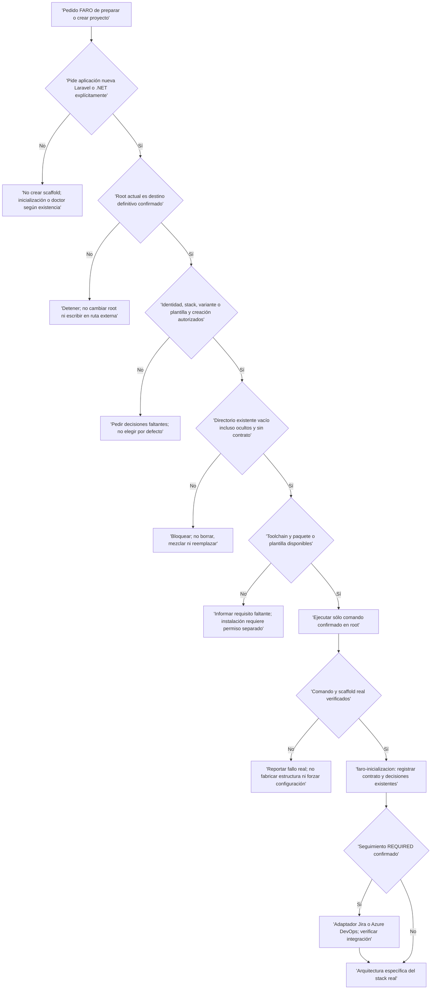
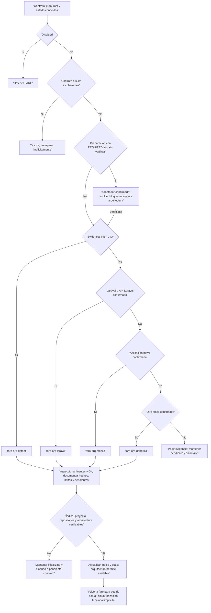
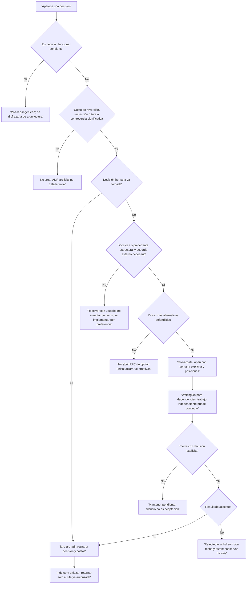

# 02 · Scaffold, arquitectura y decisiones

[Índice del flujo](README.md) · [Inicio y doctor](01-inicio-y-doctor.md)

## Separación de responsabilidades

El bootstrap de la **suite** instala skills; el bootstrap **técnico** crea una aplicación; inicialización crea el contrato; arquitectura documenta el sistema observado. No son sinónimos. FARO es un conjunto de skills guiadas por agente: los diagramas expresan decisiones y handoffs, no automatización instalada ni autorización implícita.

```text
faro: root + existencia + estado + evidencia + autorización
├── aplicación nueva autorizada y root vacío
│   ├── faro-bootstrap-dotnet → scaffold real
│   └── faro-bootstrap-laravel → scaffold real
│       └── faro-inicializacion → contrato initializing
├── proyecto existente sin contrato → faro-inicializacion
├── contrato existente parcial o inicialización repetida → faro-doctor
└── continuación de preparación
    ├── REQUIRED → adaptador confirmado → arquitectura
    └── arquitectura por evidencia
        ├── .NET/C# → faro-arq-dotnet
        ├── Laravel/API → faro-arq-laravel
        ├── móvil → faro-arq-mobile
        └── otro stack confirmado → faro-arq-generica
            └── índice + proyecto + repositorios + arquitectura verificables → available

Decisión técnica significativa, bajo demanda
├── abierta + acuerdo externo necesario + alternativas reales → faro-arq-rfc
│   └── accepted → faro-arq-adr
└── ya tomada y digna de registro → faro-arq-adr
```

Las ramas iniciales se aplican a ambos stacks: el contrato viene después del scaffold. Se carga una especialista FARO por petición y se respeta el siguiente handoff ordenado por la especialista o un cambio humano de fase. Una instalación de skills no autoriza aplicarlas al código.

## 1. Scaffold técnico antes del contrato

### Puerta de entrada y negativas obligatorias



**Un root vacío no significa sólo ausencia de código:** `.git`, `.env`, archivos ocultos, `AGENTS.md`, `context/` o cualquier otro contenido bloquean el scaffold. No se borran para habilitarlo. Tampoco se cambia el root dentro de esta ruta. Si el proyecto técnico ya existe, no usar bootstrap: inicializar el contrato ausente y documentar la arquitectura real. Si ya hay contrato FARO, un pedido de inicializar va a doctor, incluso parcial.

### .NET/C#: `faro-bootstrap-dotnet`

| Paso | Entrada o evidencia | Acción permitida y límite |
| --- | --- | --- |
| Confirmar alcance | Destino, identidad, tipo nuevo, .NET/C#, plantilla exacta y autorización de creación | No elegir `webapi`, `classlib`, `console`, `worker`, `blazor` u otra por preferencia del agente; debe estar confirmada y existir en el SDK real. |
| Prerrequisitos | `dotnet` disponible y `dotnet new list <TEMPLATE>` reconoce la plantilla | No instalar SDK, templates, workloads ni herramientas sin autorización independiente. |
| Crear | `dotnet new <TEMPLATE> --name <PROJECT_NAME> --output .` | Sólo argumentos confirmados. No agregar solución extra, tests, autenticación, EF Core, Docker, base de datos o código de dominio no solicitado. |
| Verificar | Al menos `.csproj` o `.sln`, `dotnet --info`, proyectos, estructura y `Program.cs` si existe | `dotnet build --no-restore` sólo si puede hacerse sin restaurar ni modificar el proyecto; registrar fallo real sin alterar configuración para que pase. |
| Handoff | Proyecto técnico real, no carpeta simulada | `faro-inicializacion` y, después, `faro-arq-dotnet`; el contrato no debe volver a pedir otro scaffold. Con `REQUIRED`, respetar el adaptador intermedio de inicialización. |

Es la única ruta FARO autorizada para `dotnet new` de un proyecto nuevo. Su permiso no incluye Git, commits, publicación de paquetes, despliegue, servicios externos, secretos ni cambios adicionales de configuración. No leer `.env`, user secrets, certificados, tokens ni valores potencialmente sensibles de `appsettings`.

### Laravel/API: `faro-bootstrap-laravel`

| Paso | Entrada o evidencia | Acción permitida y límite |
| --- | --- | --- |
| Confirmar alcance | Root definitivo, identidad, tipo nuevo, Laravel/API, variante y autorización | Si falta variante, proponer Laravel estándar sin starter kit; no elegir Breeze, Jetstream, Sail, Livewire, Inertia ni base de datos por defecto. Proponer no equivale a ejecutar sin confirmación. |
| Prerrequisitos | `php`, `composer` y resolución del paquete solicitado | No instalar herramientas ni dependencias del sistema sin autorización independiente. |
| Crear | Para estándar: `composer create-project laravel/laravel .` | Restricción de versión o variante sólo con argumentos confirmados; no agregar kits, servicios, migraciones propias, credenciales ni dominio. |
| Verificar | `artisan`, `composer.json`, `composer.lock`, `app/`, `bootstrap/`, `config/`, `database/`, `public/`, `resources/`, `routes/`; `php artisan --version` | Prueba Laravel sólo si dependencias y entorno la permiten. No modificar configuración para forzar éxito ni leer `.env` generado. |
| Handoff | Laravel real verificado | `faro-inicializacion` y luego `faro-arq-laravel`, sin repetir creación; respetar integración `REQUIRED` si corresponde. |

Es la única ruta FARO autorizada para `composer create-project` de un Laravel nuevo. No inicializar Git, hacer commit, publicar, desplegar, instalar kits ni configurar servicios externos por arrastre del pedido de scaffold. Un fallo de Composer/PHP se informa, no se reemplaza por archivos de ejemplo fabricados.

## 2. Inicialización y arquitectura: cómo se elige una sola rama

La [página 01](01-inicio-y-doctor.md#3-inicialización-qué-observa-qué-pregunta-y-qué-escribe) describe consulta agrupada, plantillas y doctor de cierre. El contrato queda `initializing`; `new` es el estado inicial de la plantilla, no permiso de intake. `disabled` detiene FARO. Un seguimiento `REQUIRED` y proveedor confirmado envían primero al adaptador; no inventar credenciales, acceso o mapeos remotos. Sin stack confirmado, bloquear por la decisión faltante, no elegir genérica como sustituto de desconocimiento.



La representación lineal no impone exclusividad tecnológica. En monorepos o stacks mixtos se debe confirmar el componente y alcance; no inventar que un manifest invalida otro ni ejecutar todas las skills a la vez. .NET posee metodología propia: no enviarlo a genérica por comodidad. Las fuentes de cada componente se registran sin escribir contratos en repositorios externos indexados.

### Qué mira cada arquitectura y qué produce

| Ruta | Evidencia a inspeccionar | Salida gobernada |
| --- | --- | --- |
| `faro-arq-dotnet` | `.sln`, `.csproj`, `global.json`, props/targets centrales, `Directory.Packages.props`, `NuGet.Config`, locks y configuración no sensible. SDK/TargetFramework/C# declarado, referencias, paquetes, `Program.cs`, entradas HTTP/CLI/jobs/UI, persistencia, contratos, consumidores, Blazor si existe, pruebas y CI. | `context/architecture-dotnet.md`, usando su plantilla canónica. Distingue nuevo scaffold/existente; documenta patrones coexistentes o ambigüedad sin elegir uno nuevo. |
| `faro-arq-laravel` | Instrucciones, `composer.json` y lock, manifest/lock JS, rutas, `app/`, recursos, persistencia, integración, frontend, pruebas, CI y despliegue no sensible. Si existe `/template`, revisar también componentes y pantallas del dominio. | `context/architecture-laravel.md`, con plantilla canónica: PHP/Laravel/frontend, comandos con fuente, módulos, contratos, integraciones, frontend, operación y pendientes. |
| `faro-arq-mobile` | Manifests/locks, configuración de plataforma, scripts/CI, proyectos nativos, EAS/fastlane cuando existan, pantallas, navegación/estado, estilos/componentes, permisos, almacenamiento, API/red, distribución y pruebas. | `context/architecture-mobile.md`, con plantilla canónica. No presupone Expo, React Native, SDK, mínimos de SO, navegación ni release. |
| `faro-arq-generica` | Stack distinto confirmado, manifests/locks, toolchain, scripts, CI, pruebas, documentación y configuración no secreta; entradas, módulos, persistencia, contratos, UI, integración y operación. | `context/architecture.md`; esta skill no declara una plantilla propia. No imponer convenciones de framework. |

Todas leen contrato e instrucciones locales y capturan ref/cambios mediante `git status --short --branch` sin alterar el código inspeccionado. Registrar fuente de versiones/comandos, fecha de inspección y pendientes. Un manifest declara restricciones; un lock acredita versiones resueltas. `dotnet --info` describe el entorno, no sustituye los archivos del proyecto. No afirmar que Git estaba limpio sin capturarlo.

### Disponibilidad y límites de discovery

- **Arquitectura permite `available`, no el scaffold ni inicialización.** Deben concordar índice, identidad/proyecto, repositorios y arquitectura verificables; actualizar `context/README.md` y `stats.json`, incluyendo `updatedAt` UTC conforme a la skill. No completar decisiones pendientes por invención ni usar el estado como sustituto de evidencia.
- Los documentos admiten pendientes explícitos y «no encontrado durante la inspección». Eso no equivale a inexistencia del elemento. Registrar una ausencia verificable no obliga a crear CI, pruebas, proveedor o base de datos.
- No modificar código, reorganizar una aplicación existente ni introducir Clean Architecture, DDD, vertical slices, repositorios o acceso a datos por preferencia. La estructura observada es una restricción; no deuda automáticamente autorizada.
- Para .NET, discovery prohíbe `restore`, build, migraciones o tests si pueden escribir, descargar o requerir configuración. Documentar comandos desde CI/scripts/docs no significa haberlos ejecutado. El permiso condicional de build del bootstrap no se transfiere a discovery.
- No copiar secretos, archivos de entorno, connection strings, tokens, certificados o claves. En móvil registrar el riesgo de un fallback sensible sin reproducirlo; permisos declarados no prueban manejo correcto de denegación. Contrastar backend/API disponible antes de afirmar su contrato.
- Si documentar arquitectura forma parte de un cambio funcional, referenciar RM/BUG/TEC y versión; pasar por `faro-req-ingenieria` antes de transformar la solicitud. Discovery no acredita aprobación funcional ni permite implementar.
- `available` habilita el ruteo del pedido, no commits, despliegue, QA conforme ni cambio de alcance. Las fases posteriores conservan sus propias puertas.

### Diferencias de fuente que no se resuelven cambiando el runtime

1. El rol de genérica dice «no Laravel/API ni móvil» sin excluir expresamente .NET, pero el router tiene ruta .NET específica y `faro-arq-dotnet` prohíbe sustituirla por genérica. Se documenta esa prioridad, no se elimina la ruta especializada.
2. Doctor omite el documento y la recomendación .NET en su búsqueda textual. No significa que la arquitectura .NET no exista; véase [limitaciones de doctor](01-inicio-y-doctor.md#límites-y-discrepancias-observadas-no-corregidas).
3. Las skills de arquitectura expresan la puerta de disponibilidad con distinto detalle: Laravel exige evidencia completa; móvil arquitectura verificable; .NET/genérica explicitan índice, proyecto, repositorios y arquitectura. No hay un script que centralice y acredite automáticamente toda esa semántica. La guía conserva el requisito de evidencia y decisiones del router/inicialización sin prometer una validación automática adicional.

## 3. Decisiones: cuándo ADR y cuándo RFC

Arquitectura describe **qué hay**. ADR conserva **por qué se decidió**. RFC pregunta **qué acordar** antes de comprometer trabajo. Los directorios `context/decisions/adr/` y `context/decisions/rfc/` nacen bajo demanda: no forman parte obligatoria de inicialización ni se crean para rellenar documentación.



El umbral ADR requiere **al menos una** condición: reversión costosa, restricción futura o controversia con alternativas defendibles. Una decisión reversible en una tarde o ya implícita como detalle del stack no exige ADR. Para RFC concurren **las tres**: costo/precedente estructural, acuerdo de personas fuera de la conversación y al menos dos alternativas defendibles. Si el usuario puede decidir aquí, no fabricar RFC: registrar ADR cuando corresponda.

## 4. Rama ADR: registro permanente, no aprobación

### Entrada, procedimiento y artefactos

1. Leer índice, arquitectura, instrucciones/Git, RM/BUG/TEC y plan si existen, índice ADR y decisiones relacionadas. Distinguir hecho, restricción aprobada y propuesta; no convertir código observado en decisión humana.
2. Inventariar `ADR-NNN-*.md`; asignar siguiente número una sola vez y verificar slug sin colisión. Crear directorio e índice `context/decisions/adr/README.md` desde `assets/adr-index.md` sólo con el primer caso válido. IDs estables, no reutilizables.
3. Crear `context/decisions/adr/ADR-NNN-<slug>.md` desde `assets/adr.md`. Frontmatter MADR: estado, fecha, decisores, `supersedes`, `superseded-by`, `related-rfc`, trazabilidad. Cuerpo: problema/contexto, opciones con costos reales, decisión humana y alcance, consecuencias positivas/negativas, alternativas descartadas y condiciones de reconsideración, reversión y evidencia.
4. Indexar ID/título/estado/relación. Enlazar desde arquitectura, plan o RM pertinente y desde `context/README.md`; no duplicar el razonamiento en todos los artefactos. Si existe workflow, preservar unidad/versiones y continuar sólo por la ruta ya autorizada.

### Estados ADR

| Estado | Cuándo es válido | Handoff o límite |
| --- | --- | --- |
| `proposed` | Todavía no hay decisión tomada | La skill admite registrar la propuesta con esa etiqueta; no llamarla decisión aceptada ni usarla para implementar. Si requiere acuerdo externo y satisface el umbral, abrir RFC. |
| `accepted` | Decisión y responsable explícitos | Registro permanente; volver a la fase autorizada. No otorga aprobación funcional por sí mismo. |
| `deprecated` | Dejó de aplicar, sin sucesor | Conservar fecha y razón; no borrar razonamiento. |
| `superseded` | Existe ADR posterior **aceptado** | Enlazar mediante `superseded-by`; el sucesor enlaza al anterior. No reemplazar historia con la decisión nueva. |

El rol dice «decisión ya tomada», pero el procedimiento contempla `proposed`. Se conserva esa distinción explícita: un borrador no demuestra acuerdo. Ningún estado ADR autoriza modificar código, dependencias, infraestructura, seguimiento remoto o workflow fuera del handoff documental autorizado. No atribuir al usuario una recomendación rechazada ni interpretar silencio como aceptación.

## 5. Rama RFC: consulta externa y bloqueo acotado

### Apertura

Leer arquitectura, RM/BUG/TEC, plan, decisiones e instrucciones; demostrar problema, afectados y alternativas. Inventariar `RFC-NNN-*.md`, asignar siguiente ID estable sin colisiones y crear el directorio sólo cuando la consulta es válida. La skill no declara una plantilla de índice RFC: no inventarla como obligación de inicialización.

Crear `context/decisions/rfc/RFC-NNN-<slug>.md` desde `assets/rfc.md`, respetando sus secciones y tablas:

- Estado `open`, trazabilidad, fecha, autores/responsables y tipo sin inventar personas.
- Resumen, problema, contexto/antecedentes, alcance y fuera de alcance.
- Opciones con pros/contras reales; eliminar la opción C si sólo hay dos defendibles.
- Decisión/estado actual que separe propuesta de acuerdo, pendientes, **fecha explícita** de comentarios y posiciones atribuibles con autor/fecha/fuente.
- Consecuencias por stakeholder, plan de acción, riesgos/mitigaciones, preguntas y referencias. Una fila de plantilla no impone responsable, fecha ni compromiso ficticios.

### Mientras está abierto

Si existe `context/workflow.json`, registrar `waitingOn` que nombre RFC e impedimento. No crear automáticamente workflow sólo por que exista un RFC: rige el carácter condicional de continuidad. No enviar a desarrollo tareas que dependan de la decisión. El router y la skill también prohíben probar como entregable o validar como aprobado ese trabajo dependiente. El trabajo independiente sí puede continuar: no bloquear todo el proyecto por una dependencia localizada.

### Cierre y retorno

| Resultado | Registro exigido | Siguiente paso |
| --- | --- | --- |
| `accepted` | Fecha, razón y decisión explícita; no consenso supuesto | Handoff a `faro-arq-adr`; el ADR permanente referencia RFC y RFC enlaza ADR. No convertir el RFC en ADR mediante edición. |
| `rejected` | Fecha, razón y posiciones conservadas | No usar la propuesta rechazada para implementar; volver a la fase aplicable con la decisión registrada. |
| `withdrawn` | Fecha y razón de retiro, conservando discusión | No tratar retiro como aceptación. |
| Sin respuesta | Registrar «cerrado sin respuesta» si corresponde | No es un quinto estado formal ni aceptación automática; no inventar resultado favorable por vencer la ventana. |

El cierre del RFC no aprueba RM, presupuesto, release ni despliegue. Incluso aceptado, se requiere el ADR que registre la decisión; luego siguen vigentes autorización/versiones de artefacto, plan y controles de fase. No atribuir posiciones inexistentes, resumir objeciones como acuerdo ni borrar historia.

## 6. Contrato de retorno y bloqueos comunes

| Situación | Respuesta correcta | Prohibido |
| --- | --- | --- |
| Toolchain o template de scaffold ausentes | Bloqueo concreto y permiso separado para instalar | Fabricar scaffold o instalar dependencias del sistema por arrastre. |
| Root no vacío o contrato parcial | No scaffold; doctor si hay contrato; respetar ruta de proyecto existente | Limpiar el destino, superponer archivos o reinicializar. |
| Stack sin evidencia | Pedir dato/evidencia y conservar pendiente | Elegir Laravel, móvil o genérica por conjetura. |
| Arquitectura incompleta para disponibilidad | Mantener `initializing`, explicitar faltante | Marcar `available` para permitir intake anticipado. |
| Arquitectura requiere decisión significativa | ADR si ya tomada; RFC si cumple tres condiciones | Implementar una preferencia como hallazgo. |
| RFC abierto | Bloquear sólo dependencias y registrar `waitingOn` cuando hay workflow | Desarrollo/QA/validación del alcance dependiente. |
| Decisión contradice ADR vigente | Resolver explícitamente y, si corresponde, ADR sucesor aceptado | Borrar/reemplazar el razonamiento anterior o ignorar restricciones. |
| Registro arquitectónico asociado a cambio | Referenciar RM/BUG/TEC y versión; respetar ingeniería y fase autorizada | Usar discovery o decisión como aprobación de alcance. |
| Skill auxiliar catalogada | Verificar instalación, habilitación, seguridad y alcance antes de uso | Afirmar que está disponible sólo por catálogo o nombre coincidente. |

Los artefactos de decisiones no reemplazan fuentes de verdad funcionales/técnicas. La continuidad conserva autorizaciones, unidad activa y versiones; un handoff no habilita otra versión. No leer ni persistir secretos o datos personales innecesarios, y no asumir autorización de commit/push/tag/deploy.

## Fuentes del repositorio

| Tema | Fuente relativa |
| --- | --- |
| Root, estados, ruteo y separación de roles | [Router FARO](../../faro/SKILL.md), [casos verificables de ruteo](../../faro/references/routing-cases.md) |
| Scaffold .NET | [Skill](../../faro/faro-bootstrap-dotnet/SKILL.md) |
| Scaffold Laravel | [Skill](../../faro/faro-bootstrap-laravel/SKILL.md) |
| Inicialización y estructura del contrato | [Skill](../../faro/faro-inicializacion/SKILL.md), [configuración](../../faro/templates/faro-workspace-config.json), [perfil](../../faro/templates/project-profile.md), [stats](../../faro/templates/stats.json), [workflow](../../faro/templates/workflow.json) |
| Arquitectura .NET | [Skill](../../faro/faro-arq-dotnet/SKILL.md), [plantilla](../../faro/faro-arq-dotnet/templates/architecture-dotnet.md) |
| Arquitectura Laravel | [Skill](../../faro/faro-arq-laravel/SKILL.md), [plantilla](../../faro/faro-arq-laravel/templates/architecture-laravel.md) |
| Arquitectura móvil | [Skill](../../faro/faro-arq-mobile/SKILL.md), [plantilla](../../faro/faro-arq-mobile/templates/architecture-mobile.md) |
| Arquitectura genérica | [Skill](../../faro/faro-arq-generica/SKILL.md) |
| ADR y estados | [Skill](../../faro/faro-arq-adr/SKILL.md), [plantilla MADR](../../faro/faro-arq-adr/assets/adr.md), [índice ADR](../../faro/faro-arq-adr/assets/adr-index.md) |
| RFC y estados | [Skill](../../faro/faro-arq-rfc/SKILL.md), [plantilla](../../faro/faro-arq-rfc/assets/rfc.md) |
| Principios adoptados, no dependencia runtime | [Referencia de decisiones NZT](../../faro/references/nzt-architecture-decisions.md), [ADR como memoria IA](../../faro/references/adr-ai-memory.md) |
| Limitaciones reales del diagnóstico | [Skill doctor](../../faro/faro-doctor/SKILL.md), [doctor.py](../../faro/faro-doctor/scripts/doctor.py), [suite_validation.py](../../faro/scripts/suite_validation.py) |

Volver a [inicio y doctor](01-inicio-y-doctor.md) o al [árbol central e índice](README.md) para continuar por requisitos, cambios, incidentes y entrega.
