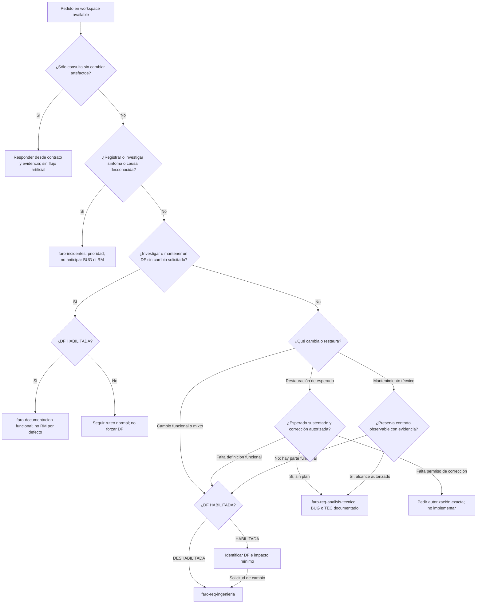
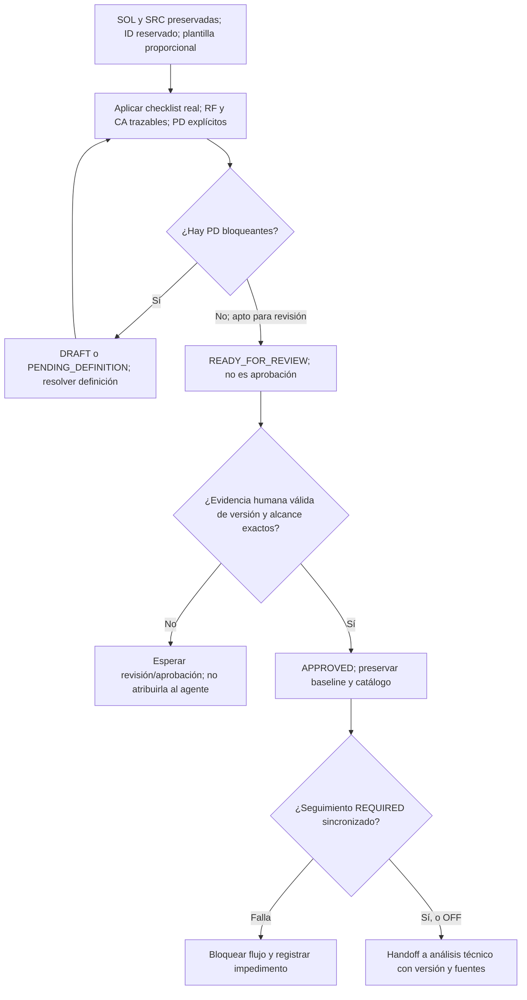
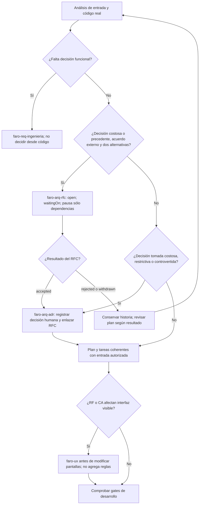
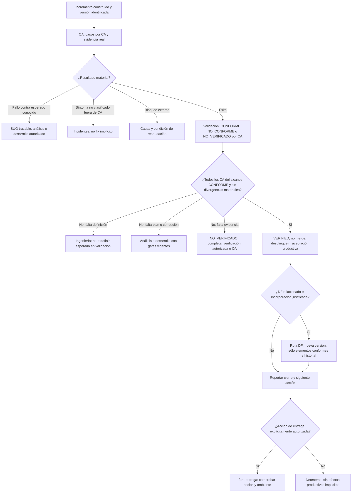

# Solicitudes, definición y desarrollo

[Índice de la guía](README.md) · [Inicio y diagnóstico](01-inicio-y-doctor.md) · [Arquitectura y decisiones](02-arquitectura-y-decisiones.md) · [Incidentes](04-incidentes.md) · [Integraciones y entrega](05-integraciones-y-entrega.md)

Esta rama explica cómo el agente, guiado por FARO, distingue una consulta de una solicitud, conserva su evidencia y entrega el trabajo a la especialidad correcta. **Los diagramas no representan un programa que invoca funciones automáticamente ni una autorización para ejecutar todas las fases.** `faro` selecciona una sola especialista FARO por petición; una especialista puede ordenar el siguiente handoff y el usuario puede cambiar de fase. Cada transición conserva sus propios permisos y gates.

## 1. Entrada: primero estado, después intención y evidencia

Antes del árbol, el router fija el root coordinador, lee contrato, perfil, índice, estado y workflow si existe, comprueba versiones y valida su continuidad antes de seguir `nextRoute`. Contrato inválido, ruta desconocida o suite incoherente se derivan a `faro-doctor`, sin reparación silenciosa. En `disabled` se detiene FARO; en `new` o `initializing` se continúa preparación/arquitectura o integración requerida, **sin intake SOL/RM/BUG/TEC/INC**. Este capítulo parte de `available`.

El orden es significativo: «investiga este error» va primero a incidentes aunque falte esperado y el perfil tenga DF habilitada. La falta de esperado en esa investigación es un pendiente, **no obliga por sí sola a crear RM**. En cambio, una solicitud de formalizar/corregir comportamiento sin definición suficiente vuelve a ingeniería o DF según perfil. No se impone INC a un BUG ya confirmado ni a cada fallo de QA contra CA conocidos.

| Clasificación | Evidencia que la distingue | Ruta y límite |
| --- | --- | --- |
| Consulta | Pregunta explicativa o de estado sin cambio documental/productivo | Respuesta desde el contrato; no reservar IDs ni crear workflow artificial. |
| RM | Alta, modificación o eliminación de comportamiento, datos, permisos, integración o interfaz | DF previo si está habilitada; luego ingeniería. No disfrazar una regla nueva como corrección. |
| BUG | Actual observado contradice esperado documentado con fuente; reproducción, entorno y evidencia identificados | Análisis técnico para registrar/planificar corrección autorizada. Conservar INC como fuente si existe, sin duplicar su investigación. |
| TEC | Objetivo técnico y evidencia de preservación del contrato observable | Registro de mantenimiento y análisis técnico. Si aparece cambio funcional, abrir la ruta de RM; TEC no concede permiso operativo. |
| Mixto | Parte funcional más restauración o mantenimiento | Identificar cada alcance y su trazabilidad; la parte funcional pasa por ingeniería. No omitirla dentro de TEC. El contrato no impone una partición universal en documentos separados. |
| INC | Síntoma reportado, investigación de causa, problema de proveedor o continuidad/cierre de incidente | [Rama de incidentes](04-incidentes.md). Investigar no autoriza corregir; cerrar investigación, recuperar impacto y corregir software son cosas distintas. |

**Fuentes:** [Router](../../faro/SKILL.md), [casos de ruteo](../../faro/references/routing-cases.md), [contrato de requerimientos](../../faro/faro-req-ingenieria/references/process-contract.md), [ingeniería](../../faro/faro-req-ingenieria/SKILL.md), [incidentes](../../faro/faro-incidentes/SKILL.md).

## 2. Preguntar decisiones, no lo que ya puede observarse

Antes de redactar o formular preguntas funcionales, leer índice, perfil, catálogo, documentos y fuentes pertinentes; inspeccionar repositorios aplicables, arquitectura, rutas/contratos, pantallas y pruebas indexadas. Buscar términos del dominio en cada repositorio disponible y registrar fuentes inaccesibles. La observación técnica no reemplaza la decisión de negocio.

| Ya observable: inspeccionar y citar | Falta no deducible: preguntar o registrar PD |
| --- | --- |
| Perfil DF y seguimiento, IDs, versiones, catálogo y reservas | Configuración pendiente o contradictoria: no asumir habilitación ni proveedor. |
| Código, pruebas, pantallas y contratos existentes, con ruta/localizador/revisión | Si el comportamiento observado es la regla deseada, sus excepciones y autoridad que lo confirma. |
| Solicitud original y fuente documental/remota aportada | Actor, resultado, permisos, límites o mensajes no definidos por fuentes autorizadas. |
| Git, cambios locales, componentes y comandos en documentación/CI | Base autorizada, propiedad de cambios ajenos o cambio de foco de una unidad activa. |
| Aprobación/versiones, autorización y alcance registrados | Aprobación humana faltante, nueva versión o autorización de efectos/entorno no cubierta. |
| Disponibilidad real de herramientas y acceso a fuentes | Acceso faltante, datos y efectos de pruebas, excepción de TDD o decisión externa necesaria. |

Etiquetas de evidencia: `CONFIRMADA` con fuente localizable; `OBSERVADA` en implementación; `DERIVADA` necesariamente desde un origen explícito; `PROPUESTA` separada de lo normativo. Código, pruebas e interfaces sólo sustentan observación salvo confirmación humana/documental de la regla. Distinguir `NO DEFINIDO`, `NO REVISADO` y `NO APLICA` justificado. Un estado remoto tampoco aprueba FARO.

**Fuentes:** [documentación funcional, procedimiento y evidencia](../../faro/faro-documentacion-funcional/SKILL.md), [contrato de evidencia](../../faro/faro-req-ingenieria/references/process-contract.md), [checklist de fidelidad](../../faro/faro-req-ingenieria/references/quality-checklist.md), [análisis técnico](../../faro/faro-req-analisis-tecnico/SKILL.md).

## 3. DF habilitada: referencia vigente, investigación separada y reserva segura

Con `functional_documentation: HABILITADA`, las solicitudes funcionales pasan primero por `faro-documentacion-funcional`; con `DESHABILITADA`, siguen la ruta estándar sin fabricar un DF. Investigar/documentar un dominio puede terminar en DF sin RM: **sólo una solicitud de cambio justifica formalizar el delta**. Una consulta de estado no activa esta ruta.

| Artefacto | Función y restricciones |
| --- | --- |
| `context/requirements/project-profile.md` | Decide habilitación. No es una autorización de implementación. |
| `context/requirements/functional-documents-catalog.md` | Localiza DF y contiene `## Documentos` / `## Reservas`; no es fuente normativa. |
| `context/requirements/DF-<NNN>-<dominio>.md` | Único DF compartible por ID, en lenguaje de negocio: propósito, alcance/exclusiones, participantes, proceso, reglas, información, casos especiales, CA y pendientes. |
| `context/requirements/DF-<NNN>-<dominio>-investigacion-interna.md` | Como máximo una nota interna por DF, mismo ID; fuentes, observaciones, hipótesis, vocabulario técnico y trazabilidad detallada. No es otro DF ni entregable al usuario. |

### Reserva e integridad de identificadores

1. Inventariar **todos** los `DF-<NNN>-*.md` de requisitos; comparar sin distinción de mayúsculas/minúsculas ID del nombre, `df_id` y entradas activas del catálogo, incluidas reservas.
2. Comprobar un solo entregable por ID y como máximo una nota con sufijo exacto `-investigacion-interna.md`, siempre con padre.
3. Ante duplicidad, IDs incoherentes o nota huérfana: **detenerse sin crear, actualizar, consumir ni renumerar automáticamente**. Pedir decisión humana sobre quién conserva ID y quién recibe otro.
4. Tras esa decisión, actualizar conjuntamente nombre, front matter, título, catálogo, referencias cruzadas y nota interna. Sólo entonces reservar mediante entrada serializada en `Reservas`; nunca máximo+1 concurrente.
5. Crear desde las plantillas y conservar identidad estable. Si no hay DF aplicable, hacer el mínimo que identifique el alcance; el resto queda `NO DEFINIDO` o `PD`.

### Baseline y relación con el cambio

- Estados DF: `DRAFT`, `PENDING_DEFINITION`, `READY_FOR_REVIEW`, `BASELINED`, `SUPERSEDED`. La skill no especifica una máquina exhaustiva de transiciones entre ellos.
- El entregable no contiene rutas de archivos, endpoints, clases, tablas, estados internos ni identificadores de fuentes; esa evidencia va a la nota interna.
- RM → DF: matriz `DF-ID#elemento → tipo de impacto → delta`, con `AGREGA`, `MODIFICA`, `ELIMINA` o `SIN_IMPACTO`.
- DF → RM: ID, versión, secciones afectadas y estado de incorporación. No duplicar el delta como comportamiento vigente.
- Un RM aprobado **no altera la baseline DF**. Tras validación funcional/técnica de esa versión, incorporar sólo elementos conformes en una nueva versión DF, actualizar historial y marcar el vínculo `INCORPORADO`.
- El DF no genera por sí solo ticket remoto: seguimiento `REQUIRED` aplica al formalizar RM, no a una investigación documental sin cambio. Al terminar, catálogo y workflow concuerdan; `nextRoute: faro-req-ingenieria` sólo si hay solicitud funcional que formalizar.

**Fuentes:** [skill DF](../../faro/faro-documentacion-funcional/SKILL.md), [plantilla entregable](../../faro/faro-documentacion-funcional/assets/functional-document.md), [plantilla de investigación interna](../../faro/faro-documentacion-funcional/assets/functional-investigation.md), [perfil](../../faro/templates/project-profile.md).

## 4. Ingeniería: del SOL a una versión aprobable, sin inventar alcance

Preservar solicitud, clasificar y reservar ID según perfil antes de referencias externas. Prefijos documentales: `RM-0001`, `BUG-0001`, `TEC-0001`; tareas `TASK-001`. No reutilizar IDs ni asignar por máximo+1 sin reserva serializada. Usar referencias completas como `RM-0001#RN-001`.

### Elegir profundidad, no burocracia

| Plantilla | Contenido disponible y criterio proporcional |
| --- | --- |
| RM-lite (`LITE`) | Solicitud/objetivo, fuentes, alcance/comportamiento, RF, CA, PD, trazabilidad y control. Útil cuando ese contenido basta para delimitar el cambio; no rebaja aprobación ni evidencia. |
| RM-standard (`STANDARD`) | Añade estructura para actores, RF/RN, RNF/restricciones, validaciones, datos, integraciones, flujo, impacto, propuestas y aprobación. |
| RM-extended | **Complemento de Standard**, no documento autónomo: añadir sólo contratos externos, estados/cálculos/compatibilidad, permisos y cortes pertinentes. No inventar payloads, estados, reglas, roles ni migraciones para completar tablas. |

Las fuentes no fijan umbrales numéricos de tamaño/riesgo para elegir nivel: elegir proporcionalmente al alcance y evidencias, sin presentar una heurística de esta guía como gate obligatorio.

| Elemento | Qué se registra | Qué no debe ocurrir |
| --- | --- | --- |
| `SOL` | Representación fiel del pedido, objetivo y alcance | Reescribirlo como solución técnica ya autorizada. |
| `SRC` | Tipo/autoridad, autor si aplica, localizador, versión/consulta y hecho sustentado | Usar memoria conversacional sin evidencia durable o tratar ticket como aprobación. |
| `OBJ`, `RF`, `RN`, `RNF`, `RES`, `ACT`, `DAT`, `INT`, `VAL` | Sólo elementos sustentados o derivados necesariamente; relacionarlos con fuente y CA | Completar por intuición reglas, actores, estados, límites, cálculos, mensajes o contratos. |
| `CA` | Resultado verificable, origen, dado/cuando/entonces y método | Agregar comportamiento nuevo dentro de un criterio. |
| `PD` | Pregunta, impacto/elementos afectados, fase, carácter bloqueante y motivo, estado, respuesta/evidencia | Bajar gravedad para avanzar o confundir propuesta con resolución. |

Un PD bloquea cuando puede cambiar resultado, datos, permisos, contratos, criterios o compatibilidad del alcance. Sus estados son `OPEN`, `RESOLVED`, `DEFERRED`; un aplazamiento no autoriza a ignorar un bloqueo vigente.

### Gate de aprobación exacta

El checklist produce `APTO_PARA_REVISION` o `REQUIERE_DEFINICION`: **no aprueba ni valida código**. Estados RM: `DRAFT`, `PENDING_DEFINITION`, `READY_FOR_REVIEW`, `APPROVED`, `SUPERSEDED`. `READY_FOR_REVIEW` no admite PD bloqueantes. Registrar `APPROVED` exige evidencia humana de **persona autorizada, versión exacta, alcance, fecha con zona y localizador**. El agente no se atribuye esa aprobación; una nueva versión no hereda la anterior.

Actualizar catálogo y artefactos estables in-place: versión/baseline/historial dentro del documento, no nombres paralelos `vN` salvo archivado solicitado. Si seguimiento es `REQUIRED`, importar el item como `SRC` o crearlo al crear RM, conservando proveedor, ID/URL, proyecto y vínculo bidireccional; sincronizar cierre/bloqueo de definición con estado remoto verificado. Si falla, bloquear. Ingeniería no escribe código.

**Fuentes:** [ingeniería](../../faro/faro-req-ingenieria/SKILL.md), [contrato](../../faro/faro-req-ingenieria/references/process-contract.md), [checklist](../../faro/faro-req-ingenieria/references/quality-checklist.md), [Lite](../../faro/faro-req-ingenieria/assets/rm-lite.md), [Standard](../../faro/faro-req-ingenieria/assets/rm-standard.md), [Extended](../../faro/faro-req-ingenieria/assets/rm-extended.md).

## 5. Análisis técnico: plan verificable y decisiones separadas

Leer perfil, contrato, instrucciones, entrada/versión, autorización y Git. Inspeccionar arquitectura, entradas, modelos, contratos, dependencias y pruebas; registrar revisión y cambios locales sin pisar trabajo ajeno. Mapear RF/RN/RNF/RES a componentes reales, separando observado y propuesto; no adaptar la regla al código.

| Estado del plan | Condición y efecto |
| --- | --- |
| `PRELIMINAR` | Análisis previo a aprobación; permite documentar impacto, no implementar. |
| `BLOQUEADO` | Contrato, decisión, autorización o evidencia impiden continuar; describir hallazgo, alcance, siguiente acción y evidencia. No esconder el bloqueo cambiando la regla. |
| `LISTO_PARA_DESARROLLO` | Entrada autorizada, repositorio inspeccionado, sin negocio implícito, tareas/verificación coherentes con la misma versión, sin RFC abierto dependiente; versión y autorización coinciden para entregar a desarrollo. |

No hay una tabla de transición automática más detallada en la fuente. Una decisión funcional faltante vuelve a ingeniería, no se resuelve como decisión técnica.

### Decisiones y UX que interceptan el camino

- **ADR:** decisión humana ya tomada y significativa; no exige RFC si el usuario puede decidirla aquí. No sustituye RM, aprobación, QA o autorización. Si contradice un ADR aceptado, regresar al análisis para justificar sucesor/supersesión explícita antes de editar.
- **RFC:** requiere simultáneamente costo de reversión o precedente estructural, acuerdo de personas fuera de la conversación y alternativas defendibles. Ventana fechada y posiciones con fuente; silencio no es aceptación. `open` bloquea implementación, QA como entregable y validación **dependientes**, no el trabajo independiente. Al aceptar, handoff a ADR; rechazar/retirar conserva el historial.
- **UX:** conoce RM/BUG, versión y RF/CA visibles; revisa arquitectura, catálogo y pantallas análogas. En Laravel/Blade inspecciona `/template`, `resources/views/template/components` y mismo dominio. Mapea navegación, jerarquía, contenido y estados de carga/vacío/error/permiso/éxito/extremos, aplicados o descartados con motivo. Lo no definido es PD hacia ingeniería. Diseño proporcional en artefacto existente; mockup sólo si se pidió. No implementa ni autoriza producto; vuelve a desarrollo cuando esté listo.

**Fuentes:** [análisis](../../faro/faro-req-analisis-tecnico/SKILL.md), [plan técnico](../../faro/faro-req-analisis-tecnico/assets/technical-plan.md), [ADR](../../faro/faro-arq-adr/SKILL.md), [RFC](../../faro/faro-arq-rfc/SKILL.md), [UX](../../faro/faro-ux/SKILL.md). Véase también [arquitectura y decisiones](02-arquitectura-y-decisiones.md).

## 6. Desarrollo: autorización por unidad, rama y selección de reglas

### Gates antes de editar

| Gate | Evidencia requerida | Si falla |
| --- | --- | --- |
| Workspace y unidad | `available`; ID, versión, alcance y autorización humana vigente; unidad identificada | No editar; registrar `waitingOn` y volver a router, ingeniería o análisis según causa. |
| Coherencia de plan/tareas | Plan `LISTO_PARA_DESARROLLO`; plan y tareas de la misma versión | Volver a análisis; no usar un plan anterior como autorización de una versión nueva. |
| Contexto técnico | `AGENTS.md`, arquitectura, instrucciones locales, Git, tarea activa, código vecino, consumidores y pruebas leídos | Obtener evidencia faltante antes de cambiar código. |
| Memoria de decisiones | Índice ADR si existe y ADR relevantes; registrar IDs revisados o ausencia del catálogo; sin RFC abierto dependiente | Contradicción con ADR aceptado → análisis/ADR sucesor. RFC dependiente → `waitingOn`. |
| Rama/base y trabajo ajeno | Rama `feature/<RM-ID>-<descripcion-kebab-case>`; crear desde base autorizada si no existe, antes de modificar | Cambios no atribuibles a unidad → bloquear y pedir decisión; no sobrescribirlos. |
| Reglas aplicables | Leer archivos seleccionados **antes de cada unidad**, registrar cuáles y excepciones en evidencia existente | Si falta o está vacío uno seleccionado, bloquear con su ruta, no inventar reglas. |
| Seguimiento `REQUIRED` | Inicio/unidad y estado remoto de trabajo sincronizados; actualización al permanecer abierta entre sesiones | Bloquear antes de editar si falla. |
| Interfaz | Handoff a UX antes de modificar pantallas | Resolver catálogo/diseño o PD sin inventar comportamiento. |

La nomenclatura de rama está escrita literalmente con `<RM-ID>` en la skill, aunque admite entrada BUG/TEC. La fuente no explicita una variante de patrón para estos IDs: no inventar aquí una convención alternativa; aclarar la aplicación si ese caso bloquea la unidad.

### Selector de lineamientos, no copia de todas las reglas

| Componente evidenciado | Leer |
| --- | --- |
| Cualquier tecnología | [Comunes](../../faro/faro-req-desarrollo/references/lineamientos-comunes.md) siempre e instrucciones locales. |
| .NET/C# por arquitectura, `.csproj` y configuración SDK | Comunes + [\.NET](../../faro/faro-req-desarrollo/references/lineamientos-dotnet.md). |
| Blazor por `.razor`, arranque, servicios y renderizado real | Comunes + .NET + [Blazor](../../faro/faro-req-desarrollo/references/lineamientos-blazor.md), sólo secciones del modo y tarea evidenciados. MVC/Razor Pages/backend .NET no lo activan por sí solos. |
| Laravel por `composer.json`, `composer.lock` y código | Comunes + [Laravel](../../faro/faro-req-desarrollo/references/lineamientos-laravel.md). No cualquier PHP. |
| Workspace mixto u otra tecnología | Selección por componente; para otra tecnología, comunes + instrucciones locales, indicando ausencia de guía específica. |

No seleccionar por nombre del repo ni extensión aislada. Instrucciones explícitas del repositorio y arquitectura aprobada prevalecen sobre defaults; la guía tecnológica especializa comunes. Una contradicción no resoluble regresa a análisis/definición antes de editar. El agente no modifica las guías para eludirlas ni copia sus reglas como nuevo contrato del workspace.

### Ejecución y cierre de la unidad

1. Confirmar unidad en plan y marcar `doing` en workflow; autorización y seguimiento deben coincidir.
2. Reutilizar implementaciones, consumidores y decisiones existentes; hacer sólo el alcance autorizado, sin renombres, dependencias o limpiezas incidentales.
3. Aplicar disciplina común de pruebas para comportamiento nuevo/corrección: **RED ejecutado por el fallo real → GREEN mínimo → REFACTOR con suite relevante en verde**. Si falta entorno o una prueba automatizada útil, registrar motivo y acordar explícitamente excepción/verificación alternativa. No omitirlo en silencio.
4. Ejecutar pruebas relevantes y checks existentes, revisar diff contra lineamientos; compilación, inspección y prueba son resultados distintos.
5. Actualizar tareas, evidencia, fuentes técnicas y workflow con resultado y `nextRoute`. En seguimiento requerido, publicar hitos por unidad material completada/bloqueada, no cada comando, archivo o intento.
6. Reportar cambio, comprobaciones, límites y siguiente ruta; QA de aplicación va a `faro-qa-ejecucion`. Un fallo derivado del cambio se corrige dentro de la unidad; ambigüedad funcional vuelve a ingeniería.

Desarrollo no declara conformidad funcional ni realiza commit/PR/despliegue implícitos; no usa producción sin autorización ni expone secretos.

**Fuentes:** [desarrollo](../../faro/faro-req-desarrollo/SKILL.md), [lineamientos comunes](../../faro/faro-req-desarrollo/references/lineamientos-comunes.md), [tareas](../../faro/faro-req-analisis-tecnico/assets/tasks.md), [comentarios de seguimiento](../../faro/references/comment-format.md).

## 7. QA: ejecutar casos por CA, separar fallo de síntoma no clasificado

QA recibe RM/BUG/TEC y versión, incremento y tareas implementadas, más autorización de **entorno, datos y efectos materiales** (mensajes, pagos, borrados, integraciones). Lee CA/plan/tareas/arquitectura/evidencia/workflow y conoce las limitaciones de terminal, HTTP y navegador. No modifica código, aprueba RM ni sustituye pruebas de implementación.

Antes de ejecutar, definir cada caso API, UI o ambos: origen, precondiciones, datos, pasos, esperado, efectos y limpieza. El esperado no se deduce del actual. Si seguimiento es `REQUIRED`, sincronizar inicio y resultado/bloqueo; fallo de sincronización inicial bloquea antes de ejecutar.

| Estado del caso | Qué acredita o falta | Handoff |
| --- | --- | --- |
| `PENDING` | Caso pendiente; no es ejecución exitosa | Completar preparación autorizada y ejecutar. |
| `PASSED` | Ejecución real contra esperado, con evidencia por CA | Éxito del alcance → validación. API no acredita UI. |
| `FAILED` | Fallo reproducible contra CA/esperado sustentado | Crear/actualizar BUG con reproducción, impacto y evidencia; análisis técnico o desarrollo según plan/autorización. No corregir durante corrida. |
| `BLOCKED` | Causa externa concreta o autorización faltante de datos/efectos | Registrar causa y condición para reanudar. No usarlo para preparación autorizada que se omitió. |

Si aparece **un síntoma fuera de esos CA sin esperado o causa confirmados**, conservar evidencia y derivar a `faro-incidentes`; no clasificar automáticamente como BUG. Un fallo conocido contra CA no necesita INC artificial. Distinguir causa sospechada de hecho; limpiar datos aislados o registrar deuda, sanitizar evidencia y dejar cada CA con caso/estado/evidencia o limitación.

**Fuentes:** [QA](../../faro/faro-qa-ejecucion/SKILL.md), [incidentes](../../faro/faro-incidentes/SKILL.md), [contrato de requerimientos](../../faro/faro-req-ingenieria/references/process-contract.md).

## 8. Validación: conformidad de la versión, no aceptación productiva

Validación compara entrega con entrada aprobada/autorizada, baseline, plan, tareas, código, revisión y entorno de **la misma versión**. Recorre RF/RN/RNF/RES/CA, no sólo la pantalla principal; registra cobertura incompleta y comportamientos agregados sin origen. Si el alcance cita ADR/RFC, verifica ADR aceptado enlazado y ausencia de dependencia abierta. Ejecuta sólo verificaciones pertinentes con comandos comprobados y permisos de entorno.

| Resultado por CA | Evidencia y consecuencia |
| --- | --- |
| `CONFORME` | Esperado y evidencia específica sostienen cumplimiento del criterio. |
| `NO_CONFORME` | Divergencia comprobada frente a la entrada autorizada; documentar hallazgo/acción/bloqueo y devolver a la fase adecuada. |
| `NO_VERIFICADO` | Falta de ejecución, acceso, cobertura u otra limitación explícita; no equivale a conforme ni a fallo demostrado. |

El reporte contiene control de evidencia, resultado por criterio (origen, esperado, método, observado/evidencia, estado), cobertura/implementación localizada, ejecuciones reales con entorno/salida/fecha, hallazgos, límites, totales y siguientes acciones. Usa evidencia QA si existe y distingue explícitamente su ausencia; no inventa una corrida para llenar el informe.

`VERIFIED` sólo procede con **todos** los CA del alcance `CONFORME` y sin divergencias materiales. No basta `TASK DONE`, build correcto o QA parcialmente verde. Validación no modifica código de producto, no aprueba RM y no autoriza merge/despliegue. Si seguimiento es `REQUIRED`, publicar resultado/bloqueo y mantener estado remoto de trabajo hasta cierre operativo; si sincronización falla, bloquear y actualizar handoff real, sin simular cierre.

**Fuentes:** [validación](../../faro/faro-req-validacion/SKILL.md), [plantilla de reporte](../../faro/faro-req-validacion/assets/validation-report.md), [contrato de estados](../../faro/faro-req-ingenieria/references/process-contract.md), [incorporación DF](../../faro/faro-documentacion-funcional/SKILL.md). Acciones de salida: [integraciones y entrega](05-integraciones-y-entrega.md).

## 9. Artefactos, continuidad y límites compartidos

| Artefacto/fuente de verdad | Se conserva | No sustituye |
| --- | --- | --- |
| RM estable en `context/requirements/` | SOL/SRC, definición, CA/PD, versión, aprobación/baseline e historial | Plan, autorización de efectos, QA ni entrega. |
| Registro BUG/TEC desde mantenimiento | Clasificación, alcance, autorización, revisión, esperado/reproducción o preservación observable; INC de origen si existe | Investigación INC ni RM cuando aparece cambio funcional. |
| `<ID>-plan-tecnico.md` | Entrada/versión/baseline/autorización, revisión, diseño observado/propuesto, compatibilidad, verificación y bloqueos | Aprobación funcional. |
| `<ID>-tareas.md` | Objetivo por TASK, origen RF/RN/CA o justificación, archivos/dependencias, inicio/terminado, verificación/evidencia/bloqueo e historial | Estado de validación de la entrega. |
| Casos/evidencia QA | Por CA, entorno/datos/efectos, ejecución, resultado y limpieza | Conformidad de validación ni aceptación productiva. La skill no fija aquí una plantilla/nombre único de archivo QA. |
| Reporte de validación | Resultado por CA, cobertura, ejecuciones, hallazgos, límites y conclusión | Merge, despliegue ni cierre de impacto de un INC. |
| `context/workflow.json` condicional | `active`, `phase`, `authorization` (`status`, `source`, `artifactVersion`, `scope`), `currentUnit`, `waitingOn`, `nextRoute`, `notes`, fecha/esquema | Contenido completo de DF/RM/planes/tareas ni autorización de otra versión. |

No mezclar vocabularios: las **unidades de workflow** usan `todo`, `doing`, `done`, `dropped` (máximo una `doing`); las **tareas** usan `TODO`, `IN_PROGRESS`, `BLOCKED`, `DONE`; el **estado de entrega** usa `NOT_STARTED`, `IN_DEVELOPMENT`, `BLOCKED`, `IMPLEMENTED`, `VERIFIED`. QA y validación tienen los estados propios de las secciones anteriores. `DONE` no equivale a `VERIFIED`.

La plantilla workflow comienza con campos de actividad nulos y `authorization.status: none`; no enumera por sí sola todos los valores o estructuras posibles. No inventar un estado nuevo ni tratar `nextRoute` como permiso de ejecución: se valida contra la suite y se comprueban gates de la fase receptora. Preservar una unidad activa ajena; un cambio de foco necesita decisión humana.

En seguimiento `REQUIRED`, usar proveedor configurado y workflow remoto verificado; el estado remoto es avance operativo, no aprobación. Cada fase sincroniza sus hitos materiales y bloquea ante fallos donde lo prescribe su skill. Comentarios concisos según formato central, no transcript ni secretos. Una aprobación RM nunca permite por sí sola operaciones externas, merge o despliegue; éstos requieren la ruta y autorización específicas de entrega.

**Fuentes:** [router e invariantes](../../faro/SKILL.md), [plantilla workflow](../../faro/templates/workflow.json), [plan](../../faro/faro-req-analisis-tecnico/assets/technical-plan.md), [tareas](../../faro/faro-req-analisis-tecnico/assets/tasks.md), [mantenimiento BUG/TEC](../../faro/faro-req-analisis-tecnico/assets/maintenance-record.md), [contrato](../../faro/faro-req-ingenieria/references/process-contract.md), [formato de seguimiento](../../faro/references/comment-format.md), [incidentes y foco activo](../../faro/faro-incidentes/SKILL.md).

## 10. Huecos y diferencias de granularidad de las fuentes

Estos puntos describen los límites de la documentación fuente; **no agregan reglas al runtime**:

- Las plantillas RM no definen umbrales cerrados para Lite/Standard/Extended. Extended es expresamente complemento a Standard.
- La skill DF exige fuentes, glosario, actores/permisos, RF/RN/RNF, restricciones, integraciones y trazabilidad/historial de baselines; su plantilla entregable es más breve y no presenta todas esas secciones ni la matriz RM explícitamente. Usar la plantilla no basta para acreditar todo el procedimiento; mantener evidencia técnica fuera del DF.
- El verificador DF comprueba integridad parcial: lee IDs de `## Documentos`, no valida reservas serializadas, y no exige `df_id` cuando falta; además espera una sección/formato de habilitación que la plantilla general de perfil no trae literalmente. No sustituye inventario y revisión humana del procedimiento.
- La plantilla de mantenimiento dice volver a ingeniería si falta esperado; router/contrato/skills actuales dan prioridad a incidentes **cuando el pedido es investigar un síntoma**. Son contextos distintos: no usar aquella frase para crear RM por anticipado ni para saltar el intake de investigación.
- La rama de desarrollo conserva el patrón literal `feature/<RM-ID>-<descripcion-kebab-case>` sin detallar una variante BUG/TEC. No se corrige esa ambigüedad mediante una regla nueva en esta guía.
- QA no aporta un asset de casos ni ruta canónica en su directorio; workflow no es un esquema exhaustivo de sus campos en la plantilla. Esta guía no crea formatos obligatorios adicionales ni una máquina de estados automática.

**Fuentes:** [plantillas RM](../../faro/faro-req-ingenieria/assets/rm-extended.md), [skill DF](../../faro/faro-documentacion-funcional/SKILL.md), [asset DF](../../faro/faro-documentacion-funcional/assets/functional-document.md), [verificador DF](../../faro/faro-documentacion-funcional/scripts/verify-functional-documentation.py), [perfil](../../faro/templates/project-profile.md), [mantenimiento](../../faro/faro-req-analisis-tecnico/assets/maintenance-record.md), [router](../../faro/SKILL.md), [desarrollo](../../faro/faro-req-desarrollo/SKILL.md), [QA](../../faro/faro-qa-ejecucion/SKILL.md), [workflow](../../faro/templates/workflow.json).
