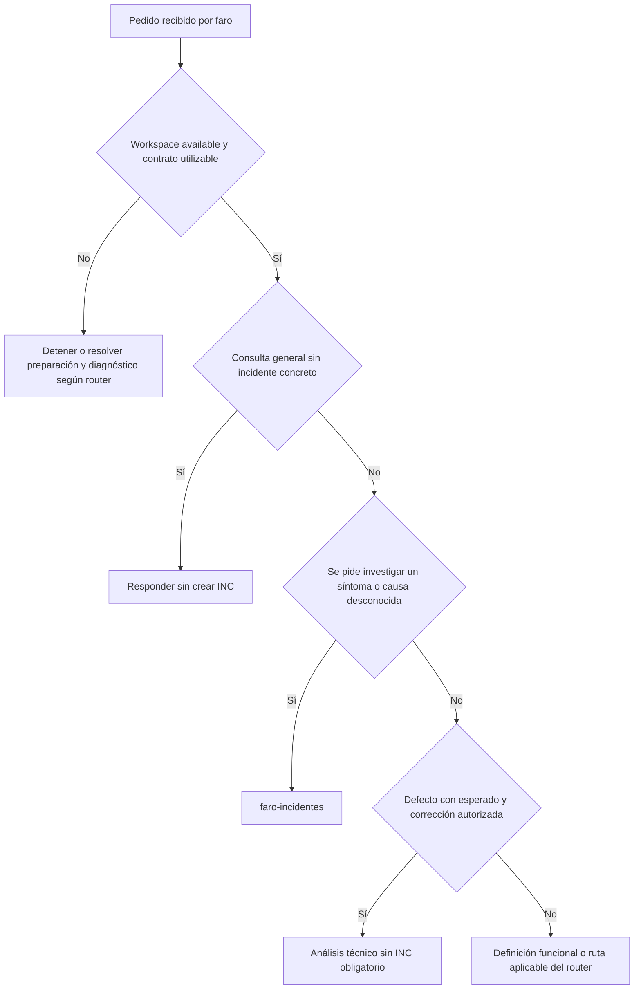
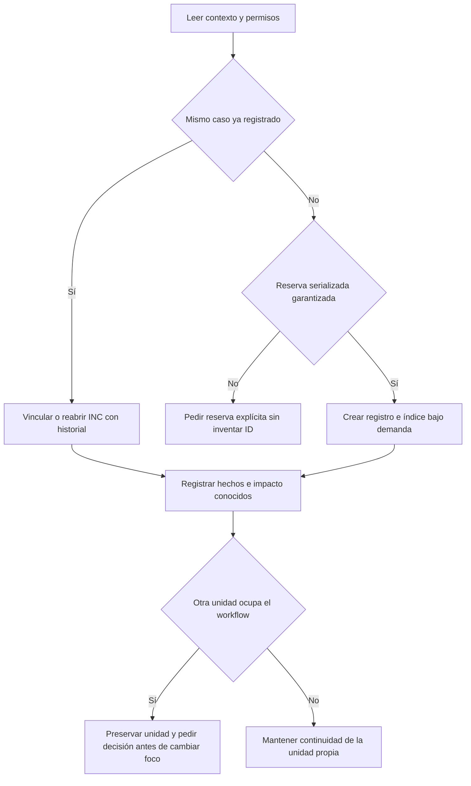
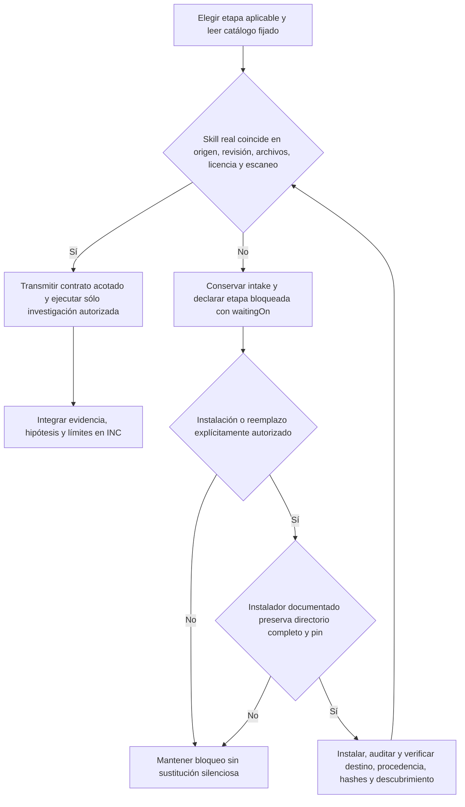
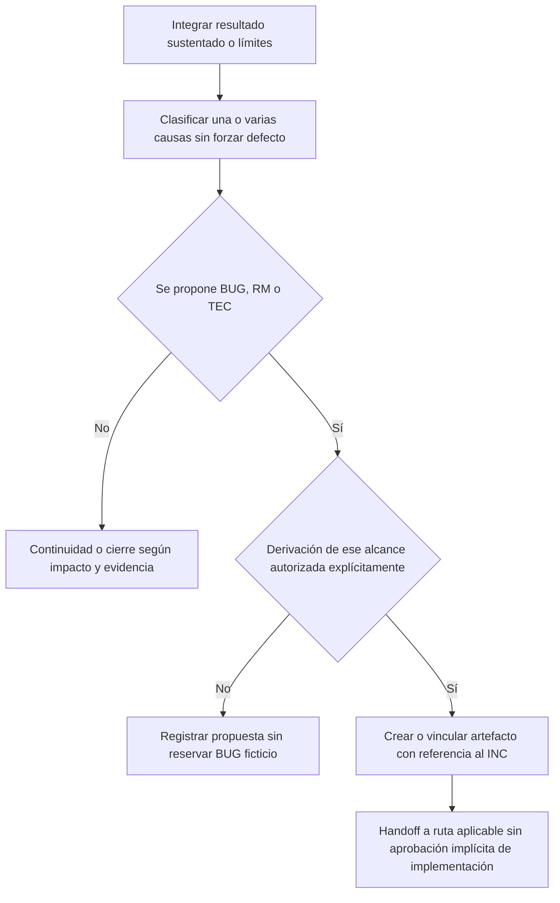
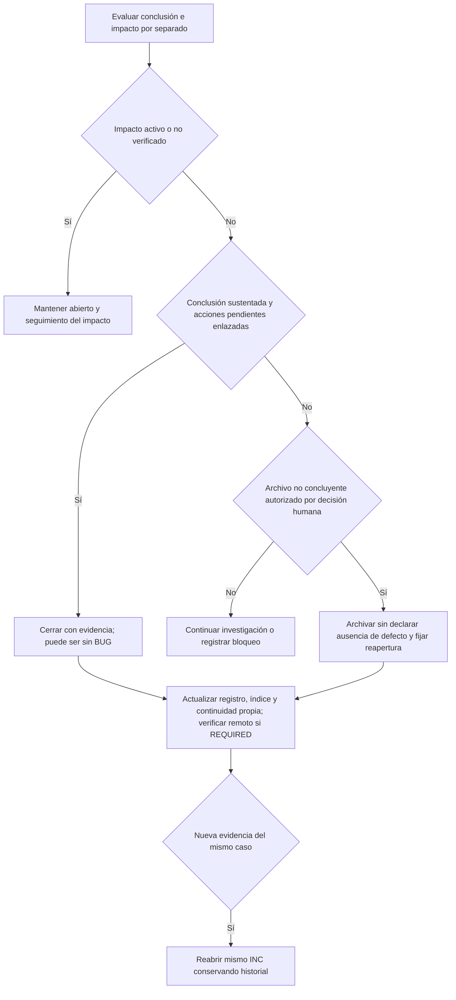

# 04 — Incidentes: del síntoma a una conclusión sustentada

[Volver al índice](README.md) · [Integraciones y entrega](05-integraciones-y-entrega.md)

## Alcance y autoridad

Un reporte no confirma un defecto. `faro` decide la ruta y `faro-incidentes` gobierna registro, permisos, investigación auxiliar, clasificación, derivación y cierre. Investigar **no autoriza corregir**, instrumentar, operar, hacer rollback ni desplegar. Estas son instrucciones Markdown para el agente: no un motor ejecutable que aplique automáticamente las transiciones de los diagramas.

El registro INC, la conclusión causal, la recuperación del impacto y una eventual corrección son objetos distintos. `fix` describe una implementación o un commit; no introduce un tercer artefacto obligatorio entre INC y BUG.

**Fuentes:** [router y prioridades](../../faro/SKILL.md), [skill de incidentes](../../faro/faro-incidentes/SKILL.md).

## 1. Entrada: investigar un síntoma o corregir un defecto probado

| Entrada / decisión | Ruta y salida | Bloqueo o límite |
| --- | --- | --- |
| Consulta general sobre incidentes | Respuesta sin crear INC | No fabricar trabajo ni artefactos por explicar el proceso |
| Workspace `new` o `initializing` | Completar preparación por el router | No recibir SOL/RM/BUG/TEC/INC antes de `available` |
| Workspace `disabled` | Detener FARO | No investigar con el flujo deshabilitado |
| Error reportado, comportamiento inesperado o proveedor con causa desconocida; pedido de registrar/investigar | `faro-incidentes`; preservar el síntoma | Tiene prioridad sobre la ruta de BUG sin esperado cuando se pide investigación |
| BUG confirmado, esperado documentado y corrección autorizada, sin plan | `faro-req-analisis-tecnico` | No exigir un INC artificial |
| Fallo reproducible de QA contra CA/esperado conocido | BUG y retorno a análisis/desarrollo según evidencia | QA no corrige durante la corrida; no exigir INC |
| Síntoma de QA fuera de esos CA, sin esperado o causa confirmados | Conservar evidencia y derivar a `faro-incidentes` | No clasificarlo como BUG automáticamente |
| Falta definición funcional, pero el pedido es definir/cambiar, no investigar | DF según perfil o `faro-req-ingenieria` | El comportamiento del código actual no es aprobación funcional |

**Fuentes:** [ruteo e invariantes](../../faro/SKILL.md), [cuándo usar incidentes](../../faro/faro-incidentes/SKILL.md), [QA y sus dos salidas de fallo](../../faro/faro-qa-ejecucion/SKILL.md).

## 2. Intake, reserva serializada y coexistencia con otra unidad

1. Leer contrato, perfil, índice, workflow y registros relacionados. Confirmar root coordinador, fuentes, entorno, datos, efectos y alcance de investigación autorizado. No escribir artefactos FARO en repositorios externos indexados.
2. Buscar el mismo caso por síntoma, entorno y evidencia. Si existe, vincularlo; nueva evidencia del mismo caso permite reabrir el mismo INC conservando historial. Una recurrencia distinta puede tener otro INC enlazado.
3. Para un caso nuevo, reservar `INC-0001` —formato ilustrativo— mediante el mecanismo serializado del proyecto, considerando registros **y reservas**. No reutilizar IDs ni calcular máximo + 1 sin reserva serializada. Si no se garantiza exclusión, solicitar una reserva explícita y no simularla.
4. Crear bajo demanda `context/incidents/README.md` y `context/incidents/INC-0001-<slug>.md` desde las plantillas. Agregar el índice a `context/README.md`. Los nombres no llevan versión: versión e historial se mantienen dentro del registro. La inicialización no crea estos archivos ni esta ruta exige migrar el contrato.
5. Preservar una unidad activa ajena: el INC no permite reemplazar `context/workflow.json` sin decisión humana sobre el cambio de foco. Registrar el caso no equivale a apropiarse de toda la continuidad del workspace.

| Entradas leídas | Salidas persistentes | Bloqueos / decisión pendiente |
| --- | --- | --- |
| Contrato, perfil, índices, workflow y caso reportado | Registro único, evidencia inicial, alcance autorizado e índice enlazado | Workspace no disponible, root o permisos no identificados |
| Coincidencias existentes y reservas | INC existente vinculado o ID reservado antes de publicar referencias | Falta exclusión/reserva explícita |
| Unidad activa y su autorización | Continuidad propia preservando trabajo ajeno | Cambio de foco sin decisión humana |
| Observado, esperado con fuente o pendiente, impacto y período conocidos | Síntoma sin etiqueta causal prematura | No inventar esperado, horarios, severidad ni mediciones |

**Fuentes:** [procedimiento y continuidad del INC](../../faro/faro-incidentes/SKILL.md), [plantilla del índice y reservas](../../faro/faro-incidentes/assets/incident-index.md), [plantilla del registro](../../faro/faro-incidentes/assets/incident.md), [workflow de continuidad](../../faro/templates/workflow.json).

## 3. Evidencia, hipótesis y capacidades externas

### Contrato de evidencia

El INC conserva control/autorización, reporte e impacto, evidencias, cronología, investigación, causa/conclusión, decisión/acciones, cierre/continuidad e historial. Cada referencia de evidencia identifica fuente segura, revisión/entorno/período, hecho respaldado y límites. La tabla de hipótesis relaciona hipótesis, comprobación autorizada, resultado y conclusión/límites.

Separar **observado**, **reportado**, **hipótesis** y **conclusión**. Registrar sólo reproducciones ejecutadas: demostrar un mecanismo local no prueba su ocurrencia histórica ni la versión desplegada. Conservar causas múltiples y factores contribuyentes sustentados; no forzar causa única, cinco porqués, responsables, fechas, severidad o acciones para llenar una plantilla. Sanitizar secretos, PII y payloads sensibles; una muestra de ejemplo no es evidencia.

**Fuentes:** [investigación y límites](../../faro/faro-incidentes/SKILL.md), [campos y tablas del INC](../../faro/faro-incidentes/assets/incident.md).

### Selección, verificación e instalación separadas

| Etapa | Capacidad y revisión fijada en el catálogo | Uso / salida | Bloqueo o límite |
| --- | --- | --- | --- |
| Investigación técnica | `systematic-debugging`, `obra/superpowers`, `2ce8aa15d05bd57213e6f746f953aafb7ded7a8b` | Fases 1–3: evidencia, reproducción autorizada, comparación e hipótesis; `root-cause-tracing.md` cuando corresponde | Detenerse antes de fase 4; no implementar un fix |
| Revisión/post-mortem | `incident-postmortem`, `github/awesome-copilot`, `5269f7ea2d6c3a9bfda5ed878b6726cf509121fd` | Cronología, impacto y factores contribuyentes sobre evidencia reunida | Sólo si se solicita o es proporcional a impacto/política; no obligatorio para cada reporte menor |

El catálogo fija directorio, entrada, licencia, `licenseSha256` y hashes SHA-256 de `requiredFiles`. Para investigación exige `SKILL.md` y `root-cause-tracing.md`; para post-mortem, `SKILL.md`. No se distribuyen esas implementaciones upstream dentro de FARO ni se acredita su instalación por aparecer en el catálogo.

Antes de cargar: descubrir la skill real del runtime, comparar procedencia, revisión y hashes, cargar las referencias seleccionadas y comprobar el escaneo permitido. Una skill homónima local puede ser otra variante: no reemplazarla por coincidencia de nombre. Entregar al auxiliar INC, entorno, fuentes, revisiones, alcance, permisos y salida requerida; devuelve evidencia, hipótesis contrastadas, causa sustentada o límites al orquestador.

Si falta, fue modificada, tiene otro origen o el escaneo la bloquea, conservar intake y evidencia recibida, registrar `waitingOn` y **bloquear la etapa que la necesita**, sin declarar que ocurrió ni reconstruir silenciosamente su metodología. Una etapa no aplicable no bloquea las demás.

La instalación se propone mediante el bootstrap o el instalador oficial del runtime y requiere confirmación antes de escribir; comparar cualquier homónima y confirmar su reemplazo. Preservar directorio completo y licencia, sin instalar sólo una URL raw de `SKILL.md`. En Hermes, la referencia exige documentación/help vigente y auditoría; no usar `--force`, ejecutar scripts upstream ni tratar advertencias como aprobación. Si no hay vía que preserve revisión y archivos, informar el bloqueo. Actualizar requiere autorización, revisión conjunta y nuevos commit/hashes, nunca cambiar a `main`/`latest` automáticamente. La regla pinned de incidentes prevalece sobre el procedimiento mutable de actualización de otros auxiliares.

Los auxiliares no autorizan instrumentación, cambios productivos, configuración, operaciones comerciales ni despliegues. El post-mortem no hereda `Status: Resolved`, ruta de ejemplo, personas, fechas o compromisos upstream. Un informe adicional sólo se crea si se solicita y queda enlazado al INC, sin conclusiones divergentes duplicadas.

**Fuentes:** [catálogo pinned y archivos requeridos](../../faro/references/incident-external-skills.json), [contrato, disponibilidad y límites externos](../../faro/faro-incidentes/references/capacidades-externas.md), [bootstrap: instalación de auxiliares de incidentes](../../bootstrap/SKILL.md).

## 4. Conclusión y derivación aprobada

| Resultado sustentado | Salida propuesta | Autorización / bloqueo |
| --- | --- | --- |
| Defecto propio: observado contradice esperado con fuente | BUG; autorizado y con esperado documentado → `faro-req-analisis-tecnico` | Si falta definición, volver a ingeniería de requisitos o DF según perfil; no inventarla |
| Proveedor o dependencia externa | Contrato, respuesta y seguimiento externo enlazados | No crear BUG propio automáticamente; un defecto propio al manejar la respuesta debe demostrarse y autorizarse por separado |
| Comportamiento de negocio esperado | Citar regla confirmada; cierre sin BUG si cumple condiciones | Otro comportamiento solicitado → RM/DF por ruta funcional, no disfrazarlo de corrección |
| Configuración, datos u operación | Proponer acción específica | Pedir autorización de efectos; TEC sólo para mantenimiento sin cambio funcional, nunca como permiso para operar |
| Evidencia insuficiente o no reproducido | Conclusión no concluyente, faltantes y siguiente comprobación | No equivale a «no es bug» y no habilita corrección especulativa |
| Causas combinadas | Conservar clasificaciones, evidencias y acciones separadas | No reducir artificialmente a una causa o ticket único |

La aprobación de investigación no aprueba la implementación. Crear/vincular BUG/RM/TEC exige autorización explícita del alcance; el BUG referencia la investigación, no la duplica. Mientras se investiga, `nextRoute` es `faro-incidentes`; un handoff autorizado conserva el INC como fuente y apunta a la ruta de corrección.

**Fuentes:** [conclusión, derivación y procedimiento](../../faro/faro-incidentes/SKILL.md), [análisis de BUG/TEC y estados del plan](../../faro/faro-req-analisis-tecnico/SKILL.md), [router funcional y técnico](../../faro/SKILL.md).

## 5. Seguimiento OFF / REQUIRED y excepción del item recibido

| Situación | Qué se escribe / verifica | Límite o bloqueo |
| --- | --- | --- |
| `OFF` | Registro local | No crear tickets remotos |
| `REQUIRED`, item recibido, incluso tipo Bug | Vincular ID/URL/tipo originales y verificar su workflow | El tipo no confirma defecto; no exigir item neutral adicional, duplicar ni reclasificar automáticamente |
| `REQUIRED`, alta nueva del INC | Crear item con tipo neutral autorizado y workflow verificado | No inventar un tipo Incident ni usar Bug por defecto; si falta tipo neutral, pedir decisión y bloquear el alta |
| Se propone neutral separado de un Bug recibido | Sólo tras decisión explícita y con vínculo al original | No es requisito para vincular el recibido |
| BUG derivado autorizado | Mantener IDs/URLs y vínculos bidireccionales independientes del INC | `REQUIRED` no autoriza por sí solo ese BUG ni conversión silenciosa del INC |
| Hito material, vínculo, comentario o transición | Adaptador configurado; comentario breve y lectura posterior del objetivo afectado | Si falla escritura obligatoria, evidencia local y `waitingOn`; no avanzar de fase ni declarar cierre remoto |

`DONE` del item INC representa el cierre permitido del incidente, no el fin de todas las correcciones. Publicar el commit o cerrar el BUG derivado no cierra el INC. Una conclusión sin defecto tampoco es una cancelación: `CANCELLED` requiere cancelación humana explícita. Los detalles de conexión y comentarios están en [integraciones](05-integraciones-y-entrega.md).

**Fuentes:** [seguimiento del INC](../../faro/faro-incidentes/SKILL.md), [adaptador Jira](../../faro/faro-int-jira/SKILL.md), [adaptador Azure DevOps](../../faro/faro-int-azure-devops/SKILL.md), [formato de comentarios](../../faro/references/comment-format.md).

## 6. Cierre, impacto y reapertura

Los únicos estados del registro son `ABIERTO`, `EN_INVESTIGACION` y `CERRADO`. Un bloqueo vive en pendientes y `waitingOn`, no crea otro estado ni inventa una causa.

| Entrada para cerrar | Salida requerida | Impide declarar resuelto |
| --- | --- | --- |
| Conclusión sustentada y situación del impacto verificada | Motivo, evidencia, acciones enlazadas y siguiente paso | Causa conocida sin recuperación verificada |
| Contención aplicada | Registrar qué contuvo y qué sigue pendiente | Confundir contención con corrección definitiva |
| Investigación no concluyente | Archivo sólo con decisión humana explícita, ausencia de impacto activo pendiente, límites y condición de reapertura | No reproducir no prueba ausencia de defecto |
| Corrección cerrada o publicada | Referencia independiente en el INC | Cierre automático por estado del BUG o commit |

**Fuentes:** [criterios de cierre y reapertura](../../faro/faro-incidentes/SKILL.md), [cierre/continuidad e historial de la plantilla](../../faro/faro-incidentes/assets/incident.md).

## Límites de esta descripción

El repositorio prescribe una reserva serializada, pero no aporta aquí un asignador ejecutable de INC: hay que verificar el mecanismo del proyecto o pedir reserva explícita. Los catálogos y hashes describen requisitos de disponibilidad; no demuestran skills instaladas, escaneo permitido ni investigaciones realizadas. Los diagramas explican decisiones del agente, no prueban una reproducción productiva ni su renderizado Mermaid.

**Fuentes:** [reservas](../../faro/faro-incidentes/assets/incident-index.md), [disponibilidad externa](../../faro/faro-incidentes/references/capacidades-externas.md), [pruebas offline y alcance declarado](../../tests/test_incidents.py).
