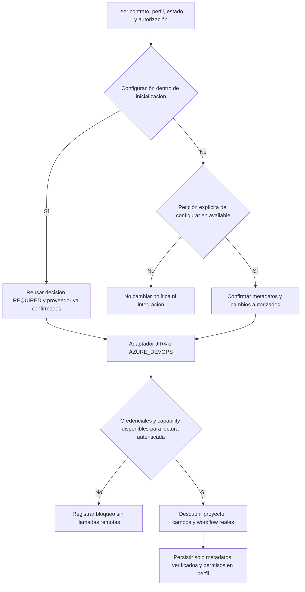
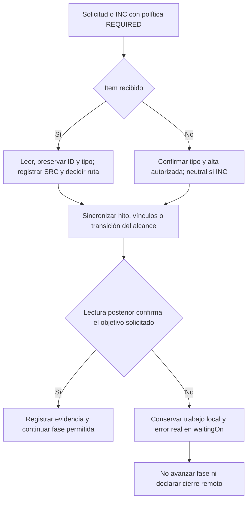
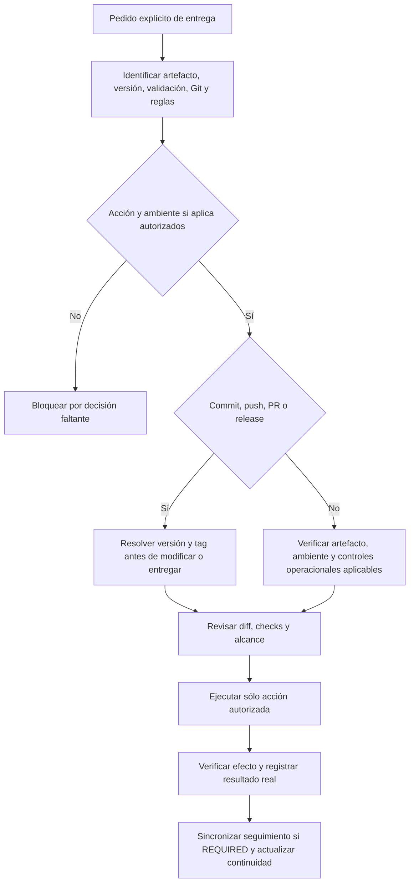
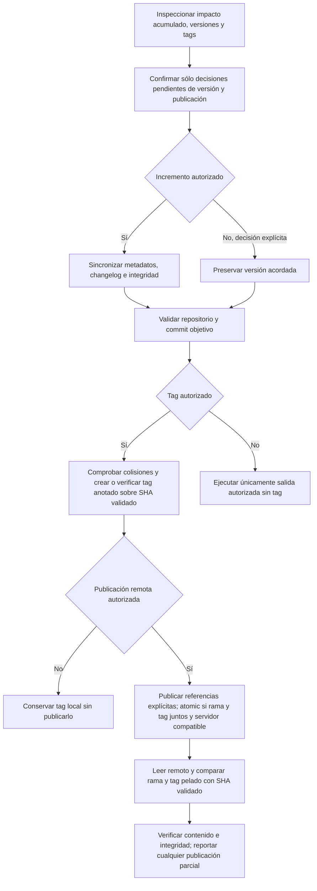
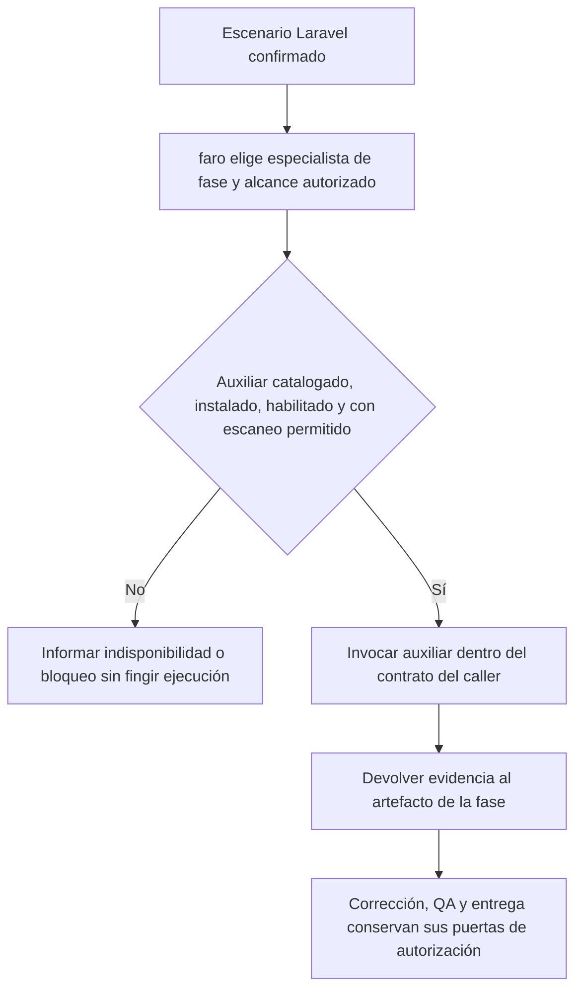

# 05 — Integraciones, capacidades auxiliares y entrega controlada

[Volver al índice](README.md) · [Incidentes](04-incidentes.md)

## Alcance: gobernanza, capability y efectos son capas distintas

`faro` elige una especialista; el adaptador de seguimiento gobierna permisos y trazabilidad; la capability técnica ejecuta llamadas autorizadas. Una integración, una skill instalada o un tag no aprueban requisitos, QA, implementación ni despliegues.

Esta página describe instrucciones para el agente contenidas en Markdown y catálogos. No hay un daemon de sincronización ni un pipeline de despliegue implementado por estos diagramas. Las herramientas del runtime y las reglas del proyecto deben permitir ejecutar y verificar cada operación real.

**Fuentes:** [router](../../faro/SKILL.md), [adaptador Jira](../../faro/faro-int-jira/SKILL.md), [adaptador Azure DevOps](../../faro/faro-int-azure-devops/SKILL.md), [entrega](../../faro/faro-entrega/SKILL.md).

## 1. Conectar/configurar: decisión humana y perfil antes de operar

| Entrada | Se pide / lee | Se verifica / escribe | Bloqueo o límite |
| --- | --- | --- | --- |
| Inicialización con `REQUIRED` y proveedor confirmado | Decisión ya recogida por inicialización; contrato, perfil, estado y fuentes | Adaptador del proveedor y metadatos no sensibles en `context/requirements/project-profile.md` | No repetir la consulta de bootstrap ni recibir solicitudes antes de `available` |
| Proyecto `available` sin integración o con cambio de política | Petición explícita de agregar/configurar y autorización humana | Registrar modo, proveedor, alcance permitido y fuente de autorización | Una URL recibida no autoriza por sí sola cambiar política |
| Jira `REQUIRED` | URL base y clave del proyecto confirmadas | Acceso al proyecto, credenciales y workflow real | URL/clave obligatorias antes de crear/importar solicitudes |
| Azure DevOps `REQUIRED` | URL de organización, proyecto, área, equipo y configuración aplicable | Lectura autenticada, tipos, campos, áreas, iteraciones y estados reales | Valores globales son propuestas hasta confirmación y verificación |
| `OFF` | Perfil y alcance del pedido | Continuidad sin alta de tickets por el seguimiento FARO | No convertir `OFF` en `REQUIRED` por inferencia |

`*.visualstudio.com` y `dev.azure.com` se tratan como el mismo proveedor `AZURE_DEVOPS`; se conserva la URL confirmada, no se transforma automáticamente. La URL de proyecto puede descomponerse como propuesta en organización/proyecto, pero esos valores se confirman. No trasladar los valores ilustrativos o predeterminados del repositorio a otro proyecto como hechos.



**Fuentes:** [ruteo de integración](../../faro/SKILL.md), [política Jira](../../faro/faro-int-jira/SKILL.md), [configuración Azure DevOps](../../faro/faro-int-azure-devops/SKILL.md), [perfil y sus campos](../../faro/templates/project-profile.md).

### Credenciales: localización segura no equivale a permiso adicional

Los adaptadores permiten usar el entorno ya inyectado o un `.env` **global de un agente**, incluso de otro agente, en sus directorios de configuración fuera del workspace y de repositorios indexados. Prohíben buscar o leer `.env` del workspace, de una aplicación o de un repositorio. No reutilizar credenciales de la aplicación. Usar valores sólo para la llamada autenticada, sin imprimirlos, exportarlos ni persistirlos en perfil, evidencia o comentarios.

- **Jira:** localizar y verificar credenciales disponibles sin revelar valores. El adaptador no fija aquí una lista canónica de nombres de variables: no inventarla. Si faltan, pedir configuración segura fuera del repositorio; una URL, exportación o texto manual sólo sustituye la fuente remota si la política **no** es `REQUIRED`.
- **Azure DevOps:** `AZDO_PAT` permanece fuera del workspace. La capability requiere `AZDO_ORGANIZATION_URL` y `AZDO_PAT`; contempla valores opcionales de proyecto, área, equipo, iteración, asignado y timeout. Los metadatos globales sólo se aceptan si coinciden con el perfil ya confirmado; si se proponen durante inicialización, exigen confirmación y lectura remota antes de persistirlos. Sin PAT, no consultar ni modificar el servicio.

**Fuentes:** [fuentes de credenciales Jira](../../faro/faro-int-jira/SKILL.md), [fuentes globales Azure DevOps](../../faro/faro-int-azure-devops/SKILL.md), [variables y seguridad de la capability](../../faro/azure-devops-rest-v7/SKILL.md).

## 2. Qué lee, verifica y escribe cada integración

| Capa | Lee / verifica | Escribe dentro del alcance autorizado | Lo que no acredita |
| --- | --- | --- | --- |
| `faro-int-jira` → `jira-rest-v3` | Perfil, URL/clave, acceso autenticado, estados/transiciones de la issue/proyecto | Issue/SRC, ID/URL en RM, referencias disponibles y comentarios/transiciones permitidos | Jira no aprueba el RM, QA ni validación |
| `faro-int-azure-devops` → `azure-devops-rest-v7` | Organización/proyecto, tipos y campos, áreas, iteraciones del proyecto/equipo, estados y valores configurados | Work item/SRC, ID/URL/organización/proyecto/área en RM, referencias y comentarios/transiciones permitidos | Azure DevOps no aprueba funcionalidad ni implementación |
| Capability `azure-devops-rest-v7` | Conectividad/identidad, configuración real y item actual antes de modificarlo; identidades accesibles si hace falta validar asignado | Llamadas reales autenticadas con `curl`, JSON/JSON Patch según operación y lectura posterior | No interpreta ni modifica el contrato FARO; no es ruta de ciclo de vida |

`azure-devops-rest-v7` está distribuida en el árbol y declarada en el manifest; eso no prueba descubrimiento, credenciales o permisos del runtime de destino. `jira-rest-v3` es una capability **externa**: no se distribuye aquí su implementación ni se puede afirmar su instalación o detallar una API no contenida en estas fuentes. Una capability ausente no se sustituye por una sincronización simulada.

La capability Azure DevOps prescribe descubrir conexión, tipos, campos del tipo, áreas, iteraciones de proyecto/equipo y estados antes de registrar valores definitivos o crear items. Para actualizar se lee primero el item y su campo/estado real; cada mutación requiere lectura posterior del objetivo. En comentarios y vínculos, verificar también esos recursos afectados, no sólo que el item siga existiendo.

**Fuentes:** [adaptador Jira](../../faro/faro-int-jira/SKILL.md), [adaptador Azure DevOps](../../faro/faro-int-azure-devops/SKILL.md), [capability técnica y operaciones](../../faro/azure-devops-rest-v7/SKILL.md), [inventario distribuido](../../manifest.json), [verificación de escrituras de INC](../../faro/faro-incidentes/SKILL.md).

### Estados operacionales, estimación y permisos

| Regla | Comportamiento codificado | Bloqueo / autorización independiente |
| --- | --- | --- |
| Mapeo remoto | `PENDING`, `DOING`, `DONE` y `CANCELLED` cuando existe; nombres reales del proyecto | No asumir nombres de Jira en Azure DevOps ni de otro proceso |
| Jira sin equivalencias | `PENDING`, `DOING` y `DONE` son obligatorias | Si falta alguna, bloquear sincronización; si sólo falta `CANCELLED`, bloquear únicamente cancelaciones |
| Inicio y trabajo | Iniciar en equivalente de `PENDING` o `DOING`; mantener trabajo durante definición, análisis, UX, desarrollo, QA, validación y entrega | El estado remoto no reemplaza autorización de fase/versionado FARO |
| Fin o cancelación | `DONE` al completar alcance autorizado; `CANCELLED` sólo tras cancelación humana explícita | Concluir que no hay defecto no equivale a cancelar el INC |
| Alta de `Task` en Azure DevOps | Campo de estimación configurado, editable y compatible; si se omite estimación, usar el valor numérico `1` | No crear si el campo no acepta el valor; no reemplazar estimación explícita ni aplicar `1` a otros tipos sin instrucción |
| Vincular una `Task` recibida | Preservar item y su información | Vincular no autoriza modificar su estimación |
| Actividad, iteración o asignado no validados | Consultar campos/valores, iteraciones del equipo e identidades accesibles según corresponda | No adivinar, sustituir silenciosamente ni aplicar porque existe un default |
| Mutaciones fuera del seguimiento básico | Asignación, prioridad, adjuntos, borrado, tiempos y sprints requieren autorización específica | En Azure DevOps también cambiar área, iteración, actividad o estimación exige autorización independiente, aunque haya defaults |

`REQUIRED` permite crear el item del RM o del INC solicitado, mantener vínculos configurados, publicar hitos relevantes y transicionar según el mapeo verificado. No habilita modificar esquemas/procesos remotos, ampliar campos por conveniencia ni crear un BUG derivado sin decisión explícita. La regla de estimación de alta de `Task` no es un permiso para reestimar items existentes. Los payloads ilustrativos tampoco autorizan sus campos por el mero hecho de mostrarlos.

**Fuentes:** [estados y límites Jira](../../faro/faro-int-jira/SKILL.md), [estimación y límites Azure DevOps](../../faro/faro-int-azure-devops/SKILL.md), [validación de valores y mutaciones](../../faro/azure-devops-rest-v7/SKILL.md), [defaults del perfil](../../faro/templates/project-profile.md).

## 3. Recepción, trazabilidad, comentarios y fallo de sincronización

Una issue recibida genera fuente `SRC-JIRA-<KEY>`; un work item, `SRC-AZDO-<ID>`. Se entregan a `faro-req-ingenieria`, salvo síntoma/causa desconocida que requiere `faro-incidentes`. Para solicitudes externas sin item recibido, el alta acompaña la creación del RM. Conservar trazabilidad bidireccional del RM y las referencias disponibles a repositorio, plan, rama, PR, QA o entrega; no copiar adjuntos ni información sensible sin autorización.

En INC, un item recibido de tipo Bug conserva ID/tipo/contenido y workflow verificado: no prueba defecto y no obliga a crear un neutral adicional. **Sólo las altas nuevas** del INC exigen tipo neutral autorizado; si falta, pedir decisión sin inventar Incident ni usar Bug por defecto. Un neutral separado del recibido necesita decisión explícita y enlace al original. INC y corrección mantienen IDs/vínculos independientes y criterios de cierre distintos; véase [incidentes](04-incidentes.md).



### Comentarios breves, no transcript

Publicar por inicio/cierre de fase, unidad material completada o bloqueada, decisión/cambio de alcance/autorización/dependencia, resultado de QA que cambie el siguiente paso o referencia durable de una operación externa autorizada. No comentar cada lectura, comando, archivo, intento o prueba. Si una unidad finaliza en la sesión sin decisión, bloqueo ni referencia durable, resumirla al cerrar su tarea inmediata.

La plantilla permite como máximo cuatro líneas, omitiendo opcionales:

```text
<Fase> · <acción o unidad> — <COMPLETADA | BLOQUEADA | EN CURSO>
<resultado verificable, en una oración>
Evidencia: <enlace o referencia durable>.
Siguiente: <acción, fase o bloqueo>.
```

No prefijo `FARO`, autor, fecha, repetición de estado remoto, comandos, hashes, conteos de pruebas, rutas locales o antecedentes ya enlazados. No afirmar aprobación, merge, validación o despliegue no ocurridos. Este formato no es el del mensaje de commit/PR.

### Fallos reales y recuperación del flujo

Si falla una sincronización obligatoria, guardar el error real sin secretos en `waitingOn` y **no pasar a la siguiente fase**. Una respuesta de escritura exitosa no basta: releer item, comentario o vínculos afectados antes de afirmar éxito. En entrega, el fallo de seguimiento impide declararla cerrada aunque la operación Git o el despliegue sí hayan sucedido; reportar ambos resultados sin inventar reversión automática.

La capability Azure DevOps distingue `401` (PAT ausente/vencido/inválido), `403` (permisos/scope), `404` (confirmar configuración y referencia), `400` (payload/campo/estado no permitido) y `429` (respetar `Retry-After`, reintento acotado). La respuesta no autoriza ampliar permisos, cambiar el proceso ni omitir el seguimiento.

**Fuentes:** [trazabilidad y fallos Jira](../../faro/faro-int-jira/SKILL.md), [trazabilidad y fallos Azure DevOps](../../faro/faro-int-azure-devops/SKILL.md), [seguimiento INC](../../faro/faro-incidentes/SKILL.md), [plantilla y frecuencia de comentarios](../../faro/references/comment-format.md), [fallos de la capability](../../faro/azure-devops-rest-v7/SKILL.md), [cierre de entrega](../../faro/faro-entrega/SKILL.md).

## 4. Entrega: cada acción necesita su alcance autorizado

| Acción / entrada | Preparación y ejecución permitida | Evidencia de salida / bloqueo |
| --- | --- | --- |
| Crear rama para incremento funcional RM | Base autorizada y convención `feature/<RM-ID>-<descripcion-kebab-case>`, no `feat/` | No pisar cambios ajenos; crear rama no autoriza publicar |
| Commit | RM/BUG/TEC, versión, validación, reglas del repositorio, Git y diff revisados | Sólo archivos del alcance; sin secretos/configuración local/generados indebidos |
| Push | Rama, remoto y referencias autorizadas; decisión de versión/tag resuelta | Verificar referencia remota; push no crea PR, release ni deploy |
| PR | Título y descripción funcional, tareas verificadas, diff y checks | Registrar referencia real; abrir PR no prueba merge |
| Release/tag | Versión, commit validado, artefacto e integridad coherentes | Un tag no prueba release de plataforma ni despliegue |
| Deploy | Ambiente nombrado, artefacto identificado, migraciones, health checks, observabilidad y rollback conocidos | Producción no se infiere; no reconstruir una versión distinta |
| Rollback | Acción y ambiente autorizados, reglas y riesgos revisados | Rollback de código no autoriza rollback destructivo de datos |

La skill lee reglas de repositorio, CI, despliegue, rollback y estado Git; declara huecos, checks, migraciones, configuración/secretos **por clave**, riesgos y evidencia de validación. Ejecuta sólo la operación solicitada, registra comando/referencia/resultado y evidencia del ambiente, actualiza workflow y documentación operacional afectada. Con seguimiento `REQUIRED`, comenta cada operación externa autorizada con su referencia durable y verifica la sincronización.



**No auto-fix durante deploy:** `faro-entrega` no implementa código. Un fallo de checks o de despliegue se registra con su resultado y límites; corregir vuelve a la fase correspondiente y a su autorización. No modificar aplicación, migraciones o configuración ni lanzar rollback no autorizado para conseguir un indicador verde. Validación no es aceptación productiva; aceptación no es deploy. Si hubo despliegue sin verificación posterior, reportarlo **desplegado, no validado**.

**Fuentes:** [rol, precondiciones, procedimiento e invariantes de entrega](../../faro/faro-entrega/SKILL.md), [límites de desarrollo](../../faro/faro-req-desarrollo/SKILL.md), [ruteo de salida](../../faro/SKILL.md).

### Mensajes de commit y PR

Primera línea: título breve; luego línea en blanco y una o dos oraciones que expliquen qué funcionalidad cambió, se agregó o se quitó, sin repetir el título, incluir código, clases o detalles internos. Al final, tras otra línea en blanco, sólo las tareas asociadas verificadas como `#<ID>`, una por línea; si no existen, omitir el bloque. Preservar saltos de línea, no aplanar el mensaje. En PR, primera línea como título y resto como descripción. El push publica el mensaje existente; no lo rehace.

**Fuente:** [mensajes de entrega](../../faro/faro-entrega/SKILL.md).

## 5. Versión, SemVer, tags y publicación verificable

### Decisión antes de tocar versión o entregar

Inspeccionar reglas del repositorio, versión declarada, diff, tags locales/remotos y alcance acumulado desde la última publicación aplicable a la línea, no sólo el último commit. Si el remoto no se puede consultar, informar el bloqueo, no afirmar disponibilidad del tag.

Respetar primero el esquema explícito del proyecto. Si usa SemVer:

| Incremento | Impacto del contrato público | Precaución |
| --- | --- | --- |
| `PATCH` | Corrección compatible de comportamiento incorrecto | Un prefijo `fix` no prueba compatibilidad |
| `MINOR` | Funcionalidad nueva compatible o deprecación pública | Reiniciar PATCH |
| `MAJOR` | Cambio incompatible que exige adaptar consumidores | Reiniciar MINOR y PATCH |

Aplicar el mayor impacto del conjunto y calcular con herramientas, no orden alfabético. `docs`, `test`, `ci` o `chore` no fuerzan incremento; tamaño del diff tampoco lo decide. Para suites también cuentan instrucciones, rutas y formatos públicos. En `0.y.z` o prereleases, seguir la política explícita sin asumir estabilidad ni publicar prerelease como estable.

Proponer versión concreta y justificar; una sola confirmación agrupa pendientes: «Propongo <versión> (<PATCH|MINOR|MAJOR>) por <motivo>. ¿Actualizamos la versión y creamos/publicamos el tag <tag> en <remoto>, junto con la entrega en <rama>?». No repetir decisiones ya autorizadas. Entregar sin incremento o sin tag también requiere decisión explícita; pedir push no autoriza versionar/taguear. Un tag sólo local no se publica; una versión ya preparada no se incrementa otra vez.

**Fuentes:** [precondiciones de entrega](../../faro/faro-entrega/SKILL.md), [decisión humana y SemVer](../../faro/faro-entrega/references/versionado-y-tags.md).

### Subproceso de publicación



1. Confirmar versión, tag, commit, rama y remoto; comprobar colisiones locales/remotas. En FARO, convención `v<MAJOR>.<MINOR>.<PATCH>`. No mover, sobrescribir, borrar o reutilizar un tag publicado para contenido diferente.
2. Si se autorizó incremento, sincronizar metadatos y changelog antes de commit. Para la **suite FARO**, la referencia enumera `manifest.json.version`, `faro/references/suite-provenance.json` (`packageVersion/ref`), `faro/references/suite-changelog.json`, `CHANGELOG.md` y `checksums.sha256`. No igualar `contractVersion` ni versiones individuales por conveniencia. Este listado documenta una entrega futura autorizada: no ordena modificar esos archivos al leer esta guía.
3. Ejecutar validaciones y revisar diff. Crear el commit y tag anotado sobre su SHA validado; firmar sólo si la política lo exige y existe capacidad. Si un tag existente coincide, verificarlo, no recrearlo.
4. Publicar sólo referencias explícitas autorizadas; preferir `git push --atomic <remoto> <ref-rama> <ref-tag>` si se publican juntas y el servidor lo admite. No `--tags` ni force push. Si queda una publicación parcial, informar exactamente qué falta.
5. Leer con `git ls-remote` y comparar rama y **commit resuelto** del tag con el SHA validado; para tag anotado usar `refs/tags/<tag>^{}`, no el SHA del objeto tag. Verificar además contenido versionado e integridad del commit etiquetado.
6. Reportar versión, commit, rama, tag local/remoto y checks reales. Una rama publicada no publica automáticamente un tag; un tag no crea PR, release de plataforma ni deploy. El bootstrap FARO exige el tag remoto de procedencia: una versión sin él queda pendiente para instalación verificada.

**Fuentes:** [publicación verificada](../../faro/faro-entrega/references/versionado-y-tags.md), [instalación y tag de procedencia](../../bootstrap/SKILL.md).

## 6. Catálogo Laravel: auxiliares del caller, no rutas nuevas

Todas las capacidades siguientes son opcionales, externas y subordinadas a una especialista FARO ya elegida. Antes de uso deben aparecer instaladas, habilitadas y con escaneo permitido; arquitectura, contrato, artefacto activo y autorización deciden el alcance. Estar catalogada no demuestra instalación ni habilita efectos extra.

| Capacidad / origen del catálogo | Escenario y caller documentados | Límites |
| --- | --- | --- |
| `laravel-development-workflow` — `Junaid-PK/laravel-development-workflow` | `faro-qa-ejecucion`, apoyo para BUG Laravel: reproducción, causa raíz, regresión y verificación proporcional | QA no modifica código; hallazgo y corrección siguen sus rutas FARO |
| `analyze-error` — `edulazaro/laraclaude` | Stacktrace Laravel reproducible → `faro-req-analisis-tecnico` | Diagnóstico no autoriza fix |
| `boost-inspect` — `edulazaro/laraclaude` | Inspección runtime autorizada y Laravel Boost disponible → `faro-req-analisis-tecnico` | Apoyo opcional, no requisito universal; no simular runtime |
| `generate-test` — `edulazaro/laraclaude` | Prueba de regresión autorizada → `faro-req-desarrollo` | Plan, versión, tarea y convenciones del repositorio siguen vigentes |
| `configure-nightwatch` — `laravel/agent-skills` | Nightwatch explícitamente autorizado → especialista FARO de la fase aplicable | El router no fija una única especialista para todos sus usos; no ampliar alcance ni instalar/configurar automáticamente |
| `starter-kit-upgrade` — `laravel/agent-skills` | Actualización selectiva de starter kit explícitamente autorizada → especialista de la fase aplicable | No equivale a crear scaffold ni aprobar una actualización general |
| `deploying-to-cloud` — `laravel/agent-skills` | Laravel Cloud explícitamente autorizado → especialista de fase aplicable; la acción de despliegue pasa por `faro-entrega` | Ambiente, checks, observabilidad y rollback siguen siendo obligatorios; sin auto-fix |



**Fuentes:** [catálogo, usos y mantenimiento](../../faro/references/laravel-external-skills.json), [filas de ruteo Laravel e invariantes](../../faro/SKILL.md), [límites de QA](../../faro/faro-qa-ejecucion/SKILL.md), [desarrollo y lineamientos](../../faro/faro-req-desarrollo/SKILL.md), [lineamientos Laravel](../../faro/faro-req-desarrollo/references/lineamientos-laravel.md), [entrega](../../faro/faro-entrega/SKILL.md).

### Instalación y actualización: dos contratos distintos

El bootstrap primero instala/verifica **todo** el árbol FARO. Después procesa el catálogo Laravel: en Hermes instala las entradas directas con el instalador oficial, y para `repository_skill_tree` obtiene el repositorio en staging, enumera `<path>/**/<entrypoint>`, inspecciona cada entrada e instala sus URLs directas; no ejecuta scripts del repositorio. Audita cada instalación. El procedimiento de árbol no equivale sólo a un alias para las tres skills destacadas en la tabla: el bootstrap prescribe enumerar las entradas reales bajo `skills/`.

Para refrescar auxiliares Laravel: comprobar estado, exigir autorización explícita de actualización y auditar después. No `--force`: una skill bloqueada se informa sin eludir el scanner. En runtime no Hermes, el bootstrap prescribe reportar indisponibilidad en vez de copiar el repositorio a mano.

El catálogo Laravel usa `branch: main` y fuentes mutables; **no** ofrece el pin inmutable ni hashes de archivos/licencia que exige el [catálogo de incidentes](../../faro/references/incident-external-skills.json). No presentar ambos contratos como equivalentes. En incidentes prevalecen confirmación explícita de instalación/reemplazo, directorio completo, revisión fijada, hashes, licencia y auditoría; una etapa bloqueada no invalida por sí sola una instalación core FARO verificada.

**Fuentes:** [bootstrap: pasos de capacidades externas](../../bootstrap/SKILL.md), [catálogo Laravel](../../faro/references/laravel-external-skills.json), [contrato externo de incidentes](../../faro/faro-incidentes/references/capacidades-externas.md).

## Límites y discrepancias visibles en las fuentes

- `jira-rest-v3` se referencia pero no se distribuye; no hay implementación local que permita documentar o demostrar sus llamadas efectivas.
- El fragmento de autenticación `AZDO_AUTH` de la capability contiene un marcador `***` y no constituye una receta ejecutable completa. Esta documentación no lo copia como comando utilizable ni corrige el runtime; las llamadas deben construirse y comprobarse en el entorno autorizado. Los ejemplos REST no se ejercieron para producir esta guía.
- Defaults y payloads ilustrativos Azure DevOps no anulan el requisito expreso de autorización independiente de campos. Se conserva esa puerta, no se presenta el ejemplo como permiso.
- El router fija algunos callers Laravel, pero para Nightwatch/starter kit/Cloud remite a la fase aplicable: no hay una ruta nueva con permisos propios. El catálogo Laravel mutable y el de incidentes pinned tienen deliberadamente garantías distintas.
- Checks del paquete o de contratos Markdown no prueban conexión real, publicación remota, deploy, disponibilidad externa ni ejecución correcta por un agente. Los diagramas no acreditan renderizado Mermaid validado.

**Fuentes:** [inventario](../../manifest.json), [capability Azure DevOps](../../faro/azure-devops-rest-v7/SKILL.md), [adaptador Azure DevOps](../../faro/faro-int-azure-devops/SKILL.md), [router](../../faro/SKILL.md), [bootstrap](../../bootstrap/SKILL.md), [pruebas offline de versionado](../../tests/test_delivery_versioning.py).
