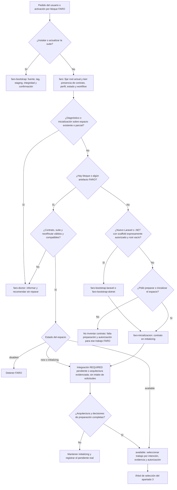
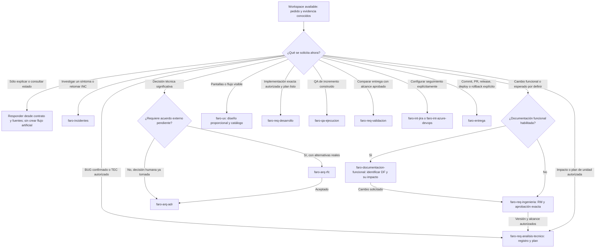

# FARO: cerebro de decisión y mapa completo de flujos

Guía de lectura del comportamiento de **FARO Suite 1.6.0**, contrato de workspace **1.13.0**. Fuentes revisadas en el commit `475ad83138895731548891de8d3b8db03cc9b3ca`.

Publicada con **FARO Suite 1.6.1**. Esta entrega agrega la documentación sin cambiar el comportamiento descrito; se conserva la revisión fuente anterior para que el mapa sea trazable. Las versiones individuales de skills y la del contrato no se igualan a la del paquete.

Esta documentación explica lo que existe; no agrega reglas, estados ni permisos. Si cambia una skill, su fuente y el contrato central prevalecen sobre este mapa.

> FARO es una suite de instrucciones para un agente, no un motor que ejecute automáticamente todos estos nodos. Una flecha significa selección de una especialista, handoff condicionado o uso de una capacidad auxiliar. No implica aprobación humana, ejecución de herramientas ni escritura remota ya realizadas.

## Por dónde empezar

| Pregunta | Árbol detallado |
| --- | --- |
| ¿Cómo instala o actualiza el agente las skills de FARO? ¿Cómo prepara un espacio nuevo? ¿Qué pide y qué revisa doctor? | [01. Inicio del espacio y doctor](01-inicio-y-doctor.md) |
| ¿Cuándo crea código inicial? ¿Cómo elige arquitectura? ¿Cuándo usa ADR o RFC? | [02. Scaffold, arquitectura y decisiones](02-arquitectura-y-decisiones.md) |
| ¿Qué hace con un cambio, BUG, TEC o consulta? ¿Cómo llega a desarrollo, QA y validación? | [03. Solicitudes y desarrollo](03-solicitudes-y-desarrollo.md) |
| ¿Cómo investiga un incidente y decide si hay una corrección o cierre sin BUG? | [04. Incidentes](04-incidentes.md) |
| ¿Cómo se relaciona con Jira/Azure DevOps y skills externas? ¿Cómo entrega commit, push, tag o deploy? | [05. Integraciones y entrega](05-integraciones-y-entrega.md) |

Los diagramas usan Mermaid para verse en GitHub o en un visor compatible. Las tablas y árboles de texto conservan la información para lectores que no rendericen gráficos.

## 1. Las tres cosas que no deben confundirse

| Operación | Quién la gobierna | Qué cambia | Qué no demuestra |
| --- | --- | --- | --- |
| Instalar/actualizar FARO | `faro-bootstrap`, fuera del inventario runtime | El árbol completo de skills del agente, con revisión/integridad y confirmación de reemplazo | No inicializa ni migra proyectos; no instala toda capacidad externa por inferencia |
| Inicializar un workspace | `faro` → `faro-inicializacion` | Contrato y perfil del root coordinador desde plantillas | No deja el proyecto `available`, no implementa una solicitud y no crea un scaffold salvo handoff autorizado |
| Trabajar sobre una unidad | `faro` → especialista según estado, evidencia y pedido | INC, DF, RM/BUG/TEC, decisiones, plan, tareas, código o evidencia según autorización | Una fase no autoriza por sí misma la siguiente ni una salida externa |

Fuentes: [bootstrap de instalación](../../bootstrap/SKILL.md), [router](../../faro/SKILL.md), [inicialización](../../faro/faro-inicializacion/SKILL.md).

## 2. Cerebro central: contexto antes de elegir trabajo



La presencia de **cualquier** artefacto FARO distingue un espacio existente de uno ausente: un contrato incompleto no habilita sobrescribirlo. El root es el directorio actual; un repositorio externo indexado no recibe escrituras del contrato FARO. Una reparación o un cambio de root requieren autorización explícita.

Antes de seguir `nextRoute`, el router pide validar el workflow con `suite_validation.py`. Una ruta retirada o desconocida se diagnostica; no se ejecuta ni se traduce silenciosamente. Reanudar tampoco hereda autorización de otra versión o alcance.

Fuentes: [router: detección y continuidad](../../faro/SKILL.md), [validación de suite y workflow](../../faro/scripts/suite_validation.py), [configuración canónica](../../faro/templates/faro-workspace-config.json).

## 3. Cerebro de trabajo en un espacio disponible



Las condiciones escritas en las flechas son gates, no permisos automáticos. Por ejemplo, terminar el plan permite proponer desarrollo, pero no convierte una autorización de análisis en autorización de implementación.

Prioridades y desvíos que cambian la ruta:

- **Investigar un error no es cambiar una regla:** un síntoma con causa desconocida entra en INC aunque falte esperado o DF. No abrir RM/BUG sólo para poder investigar.
- **BUG conocido con esperado sustentado:** puede ir directamente a análisis; no exige un INC artificial.
- **QA contra un CA conocido:** crea BUG reproducible sin imponer INC; un síntoma fuera de esos CA puede derivar a incidentes.
- **UI visible:** requiere el diseño proporcional de UX antes de implementar lo dependiente; no autoriza cambiar la regla de negocio.
- **RFC abierto:** bloquea sólo implementación/QA/validación que dependan de esa decisión, no toda actividad del proyecto.
- **Seguimiento REQUIRED:** atraviesa las fases como política. No es otra fase que otorgue aprobación funcional; si una sincronización obligatoria falla, se registra el bloqueo y no se avanza de fase.
- **Entrega:** requiere la acción de salida expresamente pedida; ni QA correcto ni validación conforme autorizan commit, push o deploy por inferencia.

Fuentes: [tabla de ruteo](../../faro/SKILL.md), [casos canónicos](../../faro/references/routing-cases.md), [contrato de requerimientos](../../faro/faro-req-ingenieria/references/process-contract.md), [incidentes](../../faro/faro-incidentes/SKILL.md).

## 4. Cadena común y caminos que no requieren esa cadena completa

```text
Preparación del espacio
    [scaffold autorizado, si hace falta]
        → inicialización → [seguimiento REQUIRED] → arquitectura → available

Cambio funcional
    [DF si está habilitada] → ingeniería y aprobación
        → análisis técnico y tareas → [UX y ADR/RFC según dependencia]
        → desarrollo autorizado → QA → validación → [entrega autorizada]

BUG conocido
    esperado con fuente y corrección autorizada
        → análisis técnico → desarrollo → QA → validación → [entrega]

TEC
    justificación de contrato observable preservado y autorización
        → análisis técnico → desarrollo → verificación proporcional → [entrega]

Incidente
    registro → capacidad externa verificada → evidencia/hipótesis/conclusión
        ├─ defecto propio confirmado → [BUG autorizado → cadena de corrección]
        ├─ negocio correcto → cierre sin BUG, o RM si se pide cambiar la regla
        ├─ proveedor/configuración/datos/operación → seguimiento o acción autorizada
        └─ no concluyente → evidencia pendiente; archivo sólo con sus condiciones

Consulta
    leer fuentes → responder; sin crear documentos o workflow por obligación artificial
```

Los corchetes indican una condición o autorización adicional, no un paso que pueda omitirse si realmente aplica. UX y decisiones técnicas se ubican antes del trabajo que depende de ellas; no existe una posición universal idéntica para todos los cambios.

## 5. Inventario: dónde está cada skill y quién la utiliza

Esta tabla cubre todo el inventario de [manifest.json](../../manifest.json). El bootstrap de instalación se lista aparte porque no es una skill runtime dentro de `faro/`.

| Skill | Responsabilidad / llamada | Árbol |
| --- | --- | --- |
| `faro` | Punto único de entrada, estado y selección de una especialista FARO | Esta página |
| `faro-inicializacion` | Materializar contrato y decisiones de preparación | [Inicio](01-inicio-y-doctor.md) |
| `faro-doctor` | Diagnóstico de espacio y suite, sin reparación implícita | [Doctor](01-inicio-y-doctor.md) |
| `faro-bootstrap-laravel` | Scaffold Laravel nuevo autorizado, antes del contrato | [Arquitectura](02-arquitectura-y-decisiones.md) |
| `faro-bootstrap-dotnet` | Scaffold .NET nuevo autorizado con plantilla confirmada | [Arquitectura](02-arquitectura-y-decisiones.md) |
| `faro-arq-laravel` | Arquitectura Laravel observada y disponibilidad | [Arquitectura](02-arquitectura-y-decisiones.md) |
| `faro-arq-dotnet` | Arquitectura .NET/C# observada y disponibilidad | [Arquitectura](02-arquitectura-y-decisiones.md) |
| `faro-arq-mobile` | Arquitectura móvil observada y disponibilidad | [Arquitectura](02-arquitectura-y-decisiones.md) |
| `faro-arq-generica` | Arquitectura del stack confirmado restante | [Arquitectura](02-arquitectura-y-decisiones.md) |
| `faro-arq-adr` | Registro permanente de decisión técnica significativa | [Decisiones](02-arquitectura-y-decisiones.md) |
| `faro-arq-rfc` | Acuerdo externo sobre alternativas y dependencia bloqueada | [Decisiones](02-arquitectura-y-decisiones.md) |
| `faro-documentacion-funcional` | DF, catálogo y trazabilidad funcional bajo demanda | [Solicitudes](03-solicitudes-y-desarrollo.md) |
| `faro-req-ingenieria` | Formalización funcional, pendientes, CA y aprobación | [Solicitudes](03-solicitudes-y-desarrollo.md) |
| `faro-req-analisis-tecnico` | Inspección real, plan, tareas y registro BUG/TEC | [Solicitudes](03-solicitudes-y-desarrollo.md) |
| `faro-req-desarrollo` | Implementar sólo una unidad autorizada de plan listo | [Desarrollo](03-solicitudes-y-desarrollo.md) |
| `faro-ux` | Pantallas/estados visibles y ajuste al catálogo frontend | [Desarrollo](03-solicitudes-y-desarrollo.md) |
| `faro-qa-ejecucion` | Casos y ejecución con evidencia por CA | [QA](03-solicitudes-y-desarrollo.md) |
| `faro-req-validacion` | Conformidad contra el alcance y la versión aprobados | [Validación](03-solicitudes-y-desarrollo.md) |
| `faro-incidentes` | Investigar sin asumir defecto y separar conclusión/corrección/impacto | [Incidentes](04-incidentes.md) |
| `faro-int-jira` | Gobernanza de seguimiento Jira; utiliza `jira-rest-v3` externa | [Integraciones](05-integraciones-y-entrega.md) |
| `faro-int-azure-devops` | Gobernanza de seguimiento Azure DevOps/Visual Studio | [Integraciones](05-integraciones-y-entrega.md) |
| `azure-devops-rest-v7` | Capacidad REST del adaptador Azure DevOps; no ruta de ciclo de vida | [Integraciones](05-integraciones-y-entrega.md) |
| `faro-entrega` | Commit/PR/release/deploy/rollback y decisión de versión/tag | [Entrega](05-integraciones-y-entrega.md) |

Instalación de la suite: [`faro-bootstrap`](../../bootstrap/SKILL.md) → [árbol de instalación](01-inicio-y-doctor.md).

## 6. Dónde recuerda las decisiones

| Fuente de verdad | Qué conserva |
| --- | --- |
| `faro/templates/faro-workspace-config.json` | Política central del contrato; archivos y estados permitidos |
| `AGENTS.md` del workspace | Bloque de instancia FARO; preserva instrucciones ajenas |
| `context/faro-workspace.json` | Manifiesto de versión/origen/artefactos, no otra política |
| `context/stats.json` | Estado e identidad del espacio; no es el estado de un BUG |
| `context/README.md` | Índice de repositorios y fuentes, no copia de su código |
| `context/requirements/project-profile.md` | Decisiones de seguimiento, proveedor y documentación funcional sin secretos |
| `context/requirements/` | DF/RM, registros y planes/tareas según rutas del perfil y las plantillas |
| `context/incidents/` | Investigación INC e índice, sólo al necesitarlos |
| `context/decisions/adr/` y `context/decisions/rfc/` | Decisiones técnicas bajo demanda |
| `context/workflow.json` | Continuidad de una unidad activa: `active`, `phase`, `authorization`, `currentUnit`, `waitingOn`, `nextRoute`, `notes` |

Fuentes: [configuración](../../faro/templates/faro-workspace-config.json), [perfil](../../faro/templates/project-profile.md), [workflow](../../faro/templates/workflow.json), [contrato funcional](../../faro/faro-req-ingenieria/references/process-contract.md).

Una unidad tiene `todo`, `doing`, `done` o `dropped`, con máximo una `doing`. Eso no es el mismo vocabulario que `initializing/available` del espacio, `APPROVED` del RM, `PASSED` de QA, `CONFORME` de validación o `CERRADO` de INC. Tampoco el estado remoto de Jira/Azure DevOps acredita aprobación FARO.

## 7. Límites de esta guía y mantenimiento

- Los gráficos describen gates y handoffs de instrucciones. Los validadores Python comprueban integridad/coherencia y algunos campos; no ejecutan ni garantizan el razonamiento de todas las skills.
- El código observado no prueba que una regla sea la aprobada ni que esa revisión esté desplegada. Los informes deben conservar la procedencia y sus límites.
- La existencia de una skill en un catálogo no demuestra instalación, descubrimiento o auditoría del runtime. Las dependencias de incidentes conservan su pin y controles propios.
- Las páginas detalladas señalan diferencias entre la política de una skill y lo que su script comprueba efectivamente. Documentarlas no las corrige ni convierte su recomendación en permiso de reparación.
- Si se cambia una ruta, revisar su diagrama, su fila de inventario, las páginas afectadas y las fuentes. No editar el runtime para hacer coincidir esta documentación.
