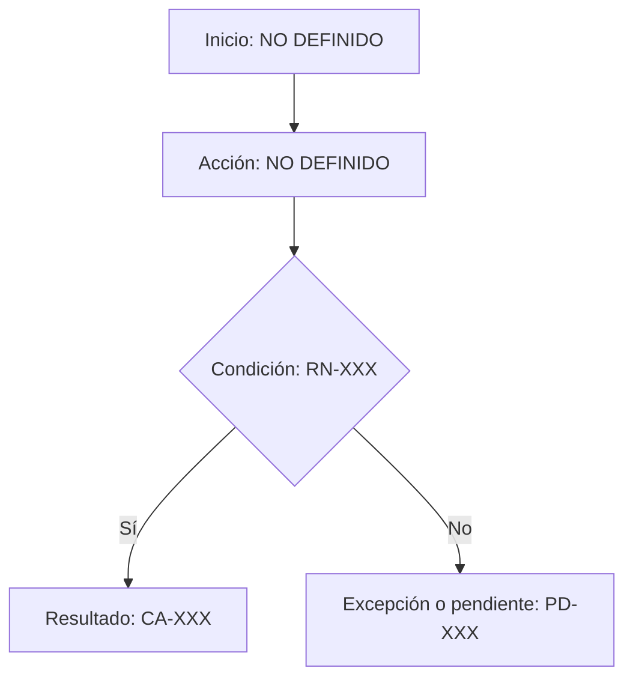
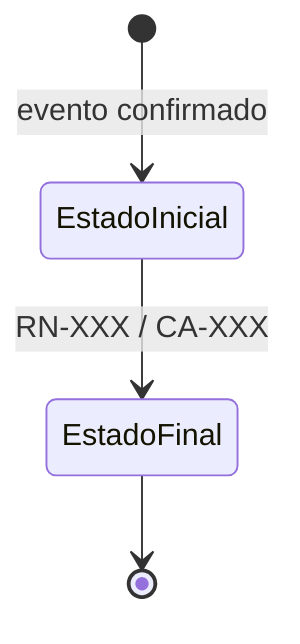

# Documento Funcional — <Dominio o proceso>

## 1. Propósito
- Qué problema o proceso cubre este documento: NO DEFINIDO.

## 2. Alcance y exclusiones
- Incluye: NO DEFINIDO.
- No incluye: NO DEFINIDO.

## 3. Participantes
| Participante | Responsabilidad |
|---|---|

## 4. Proceso operativo
| Paso | Participante | Acción | Resultado esperado |
|---|---|---|---|

### 4.1 Flujo visual en Markdown/Mermaid
- Aplicabilidad y alcance: NO DEFINIDO. El diagrama no sustituye la tabla anterior.
- Trazabilidad: RF/RN/CA/PD: NO DEFINIDO.
- Eliminar este bloque si no reduce ambigüedad; no usarlo como decoración.

### 4.2 Estados del proceso o entidad
- Aplicabilidad y entidad: NO DEFINIDO. Si no hay ciclo de vida, indicar `No aplica`.
- Transiciones y trazabilidad: NO DEFINIDO.

## 5. Reglas de negocio
| ID | Regla |
|---|---|

## 6. Información a registrar
| Información | Cuándo se registra | Uso |
|---|---|---|

## 7. Casos especiales y mensajes esperados
| Situación | Comportamiento esperado |
|---|---|

## 8. Criterios de aceptación
| ID | Dado | Cuando | Entonces |
|---|---|---|---|

## 9. Pendientes de definición
| ID | Pregunta | Impacto | Estado |
|---|---|---|---|

## 10. Control de versiones
| Fecha | Versión | Estado | Cambio |
|---|---|---|---|
