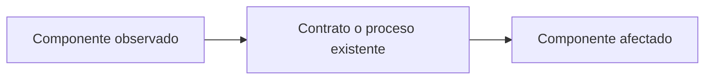

# Plan técnico — <RM-ID / BUG-ID / TEC-ID>

## Control
- Versión: 0.1. Estado: PRELIMINAR / BLOQUEADO / LISTO_PARA_DESARROLLO.
- Entrada/version/baseline/autorización/repositorio/revisión/fecha: NO DEFINIDO.

## Evidencia y diseño
| Componente observado | Hecho | Revisión/localizador | Elemento funcional |
|---|---|---|---|
| Componente existente/propuesto | Modificación | Motivo | RF/RN/RNF/RES | Efecto autorizado |
|---|---|---|---|---|

### Visual técnico en Markdown/Mermaid (cuando aplique)
- Propósito, límite técnico y trazabilidad RF/RN/RNF/RES/CA: NO DEFINIDO.
- El visual explica componentes o intercambio ya evidenciados; no decide arquitectura ni agrega contrato.

## Decisiones y compatibilidad
| DT | Decisión | Alternativas | Motivo | Restricción | Consecuencia |
|---|---|---|---|---|---|

- Datos, contratos, dependencias y reversión: NO DEFINIDO.

## Verificación y bloqueos

### Integración y retiro de refactorizaciones (si aplica)
| Origen → destino | Consumidor y registro antes/después | Retiro o delegación y compatibilidad | Entrada real y prueba de equivalencia | Revisor independiente previsto |
|---|---|---|---|---|

- Si hay coexistencia temporal: autorización, alcance de esta fase y condición/tarea de retiro. Si no hay refactorización, indicar No aplica.

### Pruebas y hallazgos
| CA/objetivo | Método | Prueba necesaria | Comando/pasos | Entorno |
|---|---|---|---|---|
| Hallazgo | Tipo | Alcance | Bloquea | Siguiente acción | Evidencia |
|---|---|---|---|---|---|

- [ ] Entrada autorizada. [ ] Repositorio inspeccionado. [ ] Sin decisiones de negocio implícitas. [ ] Tareas y verificación de la misma versión.
