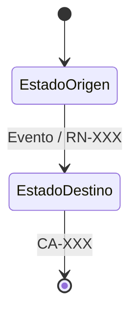

# RM Extended — complemento a RM Standard

Usar la plantilla Standard y añadir sólo las secciones pertinentes:

## Contratos externos
| INT | Operación | Transporte/endpoint confirmado | Versión | Entrada/salida referenciada | Autenticación | Fuente/PD |
|---|---|---|---|---|---|---|

## Estados, cálculos y compatibilidad
| Entidad | Estado origen | Evento | Condición | Destino | Efecto | Fuente/CA |
|---|---|---|---|---|---|---|

### Diagrama de estados Markdown/Mermaid (cuando aplique)
- Entidad, aplicabilidad y trazabilidad RF/RN/CA/PD: NO DEFINIDO.

| Tema | Definición confirmada | Casos límite | Fuente | CA/PD |
|---|---|---|---|---|
| Datos/consumidor | Compatibilidad requerida | Fuente | PD |
|---|---|---|---|

## Permisos y cortes
| Actor/dato | Acción autorizada | Condición | Fuente | CA/PD |
|---|---|---|---|---|
| Alcance propuesto | RF/RN/CA | Dependencias | Aprobación necesaria | RM separado |
|---|---|---|---|---|

No crear payloads, estados, reglas de cálculo, roles o migraciones no confirmadas.
