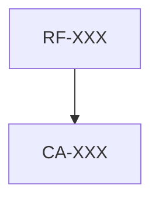

# <RM-ID> — <Título>

## Solicitud y objetivo
- SOL-001 — representación fiel: NO DEFINIDO.
- Resultado esperado, módulo y tipo de cambio: NO DEFINIDO.

## Fuentes
| ID | Tipo/autoridad | Localizador y versión | Consulta | Hecho sustentado |
|---|---|---|---|---|
| SRC-001 | NO DEFINIDO | NO DEFINIDO | NO DEFINIDO | NO DEFINIDO |

## Alcance y comportamiento
- Incluido/excluido/dependencias: NO DEFINIDO.
### RF-001 — <Comportamiento>
- Descripción, actor, fuente y CA: NO DEFINIDO.

## Criterios
### CA-001 — <Resultado verificable>
- Origen: NO DEFINIDO
- Resultado esperado: NO DEFINIDO
- Método previsto: NO DEFINIDO

## Visuales en Markdown/Mermaid (cuando apliquen)
- Propósito, aplicabilidad y trazabilidad RF/RN/CA/PD: NO DEFINIDO.
- El bloque se lee como texto en un README y no agrega comportamiento fuera del RM.

## Pendientes
| ID | Pregunta | Afecta | Fase | Bloqueante y motivo | Estado | Respuesta/evidencia |
|---|---|---|---|---|---|---|

## Impacto en conocimiento durable
| Destino | Delta autorizado | Resolución requerida | Fuente / autorización |
|---|---|---|---|
| FUNCTIONAL | NO DEFINIDO | INCORPORAR / NO_APLICA | NO DEFINIDO |
| ARCHITECTURE | NO DEFINIDO | INCORPORAR / NO_APLICA | NO DEFINIDO |
| OPERATIONS | NO DEFINIDO | INCORPORAR / NO_APLICA | NO DEFINIDO |
| REFERENCE | NO DEFINIDO | INCORPORAR / NO_APLICA | NO DEFINIDO |

Destinos: `FUNCTIONAL`, `ARCHITECTURE`, `OPERATIONS`, `REFERENCE`. La promoción permanece `PENDIENTE` hasta que `faro-cierre` comprueba `INCORPORADO` o `NO_APLICA` justificado.

## Operaciones de entrega requeridas
| Operación | Origen del alcance |
|---|---|

Mantener vacía sólo si el alcance autorizado no exige commit, PR, release, deploy ni otra operación externa.

## Trazabilidad y control
| SOL/SRC | Elemento | Regla/restricción | CA |
|---|---|---|---|
| SOL-001/SRC-001 | RF-001 | NO DEFINIDO | CA-001 |

- Calidad, versión presentada, aprobador, evidencia y baseline: NO DEFINIDO.
- No escribir APPROVED sin evidencia humana de esta versión y alcance.
- Estado, prioridad y asignación se consultan en `external_work_item` cuando el seguimiento es `REQUIRED`; no se duplican aquí.
