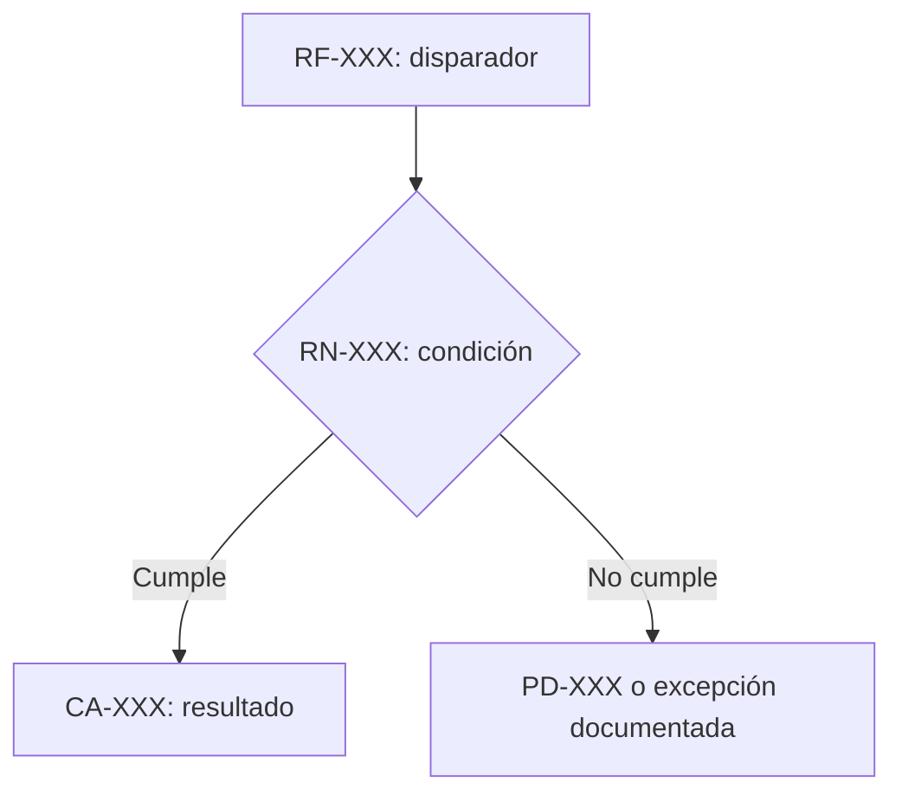

# <RM-ID> — <Título>

## Solicitud, fuentes y alcance
- SOL-001, objetivo, incluidos, exclusiones y dependencias: NO DEFINIDO.
| SRC | Tipo/autoridad | Localizador/versión | Consulta | Hecho |
|---|---|---|---|---|

## Actores, RF y RN
| ACT | Actor/responsabilidad confirmada | Fuente |
|---|---|---|

### RF-001 — <Título>
- Actor/disparador, precondiciones, resultado, fuente, relaciones y CA: NO DEFINIDO.
### RN-001 — <Título>
- Condición, consecuencia, excepciones, vigencia y RF afectados: NO DEFINIDO.

## RNF, restricciones, validaciones, datos e integraciones
| ID | Enunciado/contrato | Condición o medida | Fuente | CA/PD |
|---|---|---|---|---|

## Flujo, criterios, impacto y pendientes
| Paso | Actor | Acción/condición | Resultado | Fuente/elemento |
|---|---|---|---|---|

### Visuales en Markdown/Mermaid (cuando apliquen)
- Propósito, aplicabilidad y trazabilidad RF/RN/CA/PD: NO DEFINIDO.
- El bloque se lee como texto en un README y no agrega comportamiento fuera del RM.

### CA-001 — <Título>
- Origen, dado, cuando, entonces, método: NO DEFINIDO.
### PD-001 — <Pregunta>
- Motivo, afectados, fase, bloqueo, estado OPEN, respuesta y evidencia: NO DEFINIDO.

## Propuestas, trazabilidad y aprobación
- Propuestas separadas: NO DEFINIDO.
- Relacionar SOL/SRC → RF/RN/DAT/INT → CA.
- Calidad, versión, persona autorizada, evidencia/baseline e impacto frente a versión previa: NO DEFINIDO.
